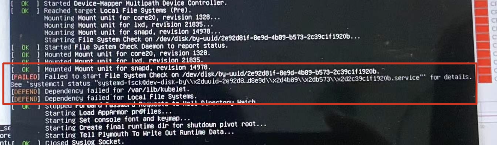
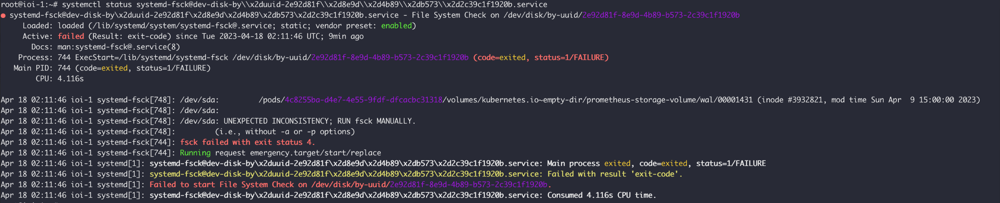
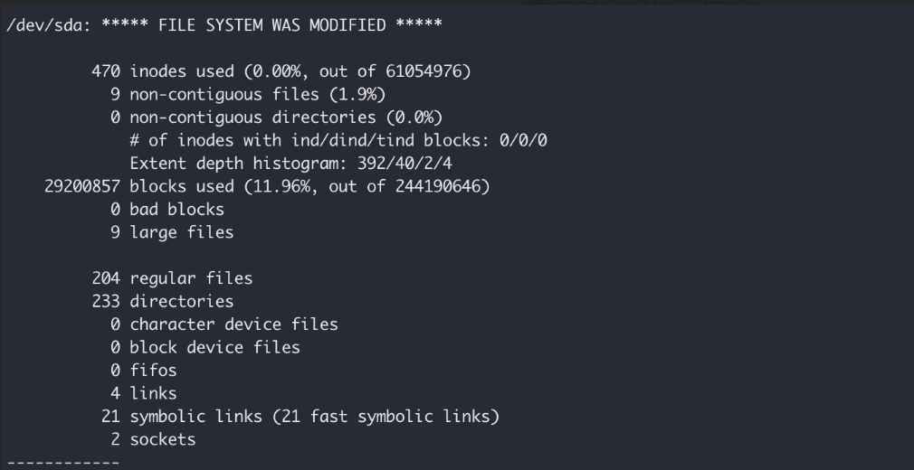

项目中使用kvm虚拟机搭建测试环境，其中一块ssd 直接passthrough到vm中，挂载在/var/lib/kubelet路径下。

由于应用程序有大量读写，并且这块测试的ssd并非企业盘，最终导致cpu大部分都处于iowait状态，vm基本不可用，无法拉起pod，删除pod也非常缓慢。

于是决定重启一下vm，看是否可以恢复环境。重启过程中发现，vm始终无法正确挂载这块直通的ssd，日志如下。



通过日志提示检查一下挂载的细节，发现`fsck failed with exit status 4`




有了这个错误提示，自然就可以去[stackoverflow](https://unix.stackexchange.com/questions/107876/fsck-died-with-status-code-4)去找个答案。


使用`fsck -yvf /dev/sda`修复文件系统后，vm可以正常重启。




Sometimes fsck shows that a filesystem has no errors, but in reality it has. I had a similar issue once, and if you want to check that filesystem, you have to use force. I'm not sure what type of a filesystem you're using, but let's assume it's ext4:

```sh
Emergency help:
 -p                   Automatic repair (no questions)
 -n                   Make no changes to the filesystem
 -y                   Assume "yes" to all questions
 -c                   Check for bad blocks and add them to the badblock list
 -f                   Force checking even if filesystem is marked clean
 -v                   Be verbose
 -b superblock        Use alternative superblock
 -B blocksize         Force blocksize when looking for superblock
 -j external_journal  Set location of the external journal
 -l bad_blocks_file   Add to badblocks list
 -L bad_blocks_file   Set badblocks list
```


### Reference

https://unix.stackexchange.com/questions/107876/fsck-died-with-status-code-4