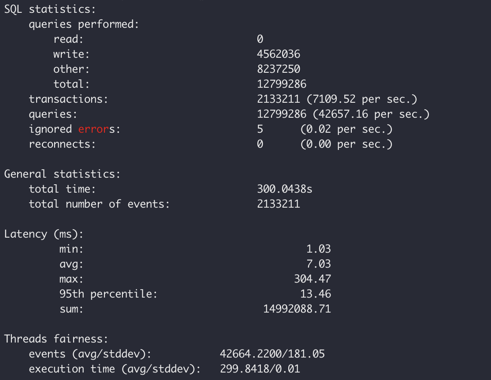
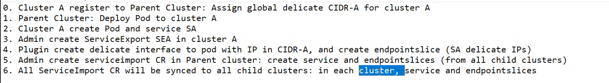
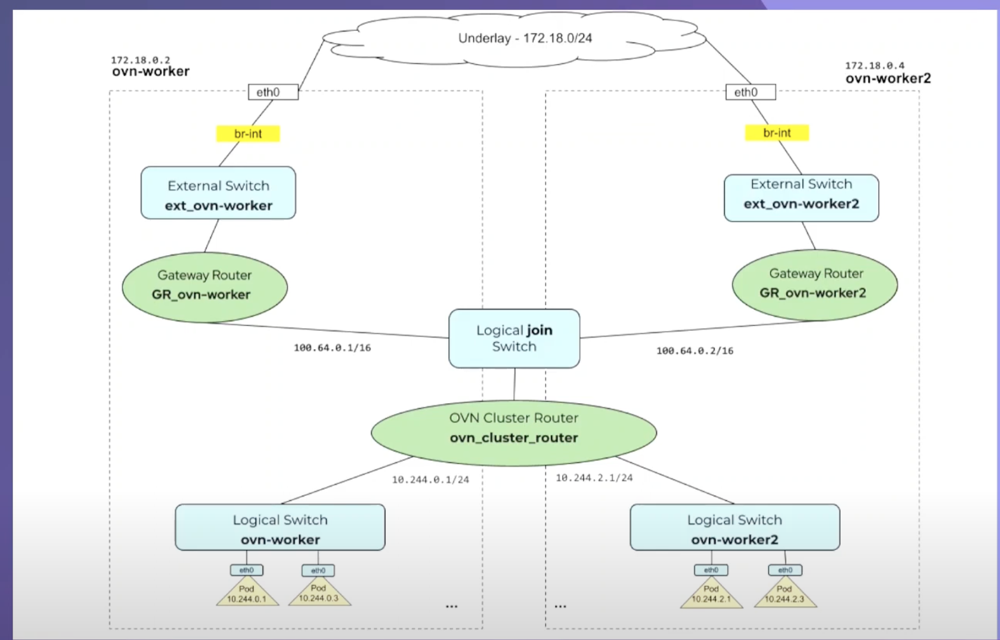
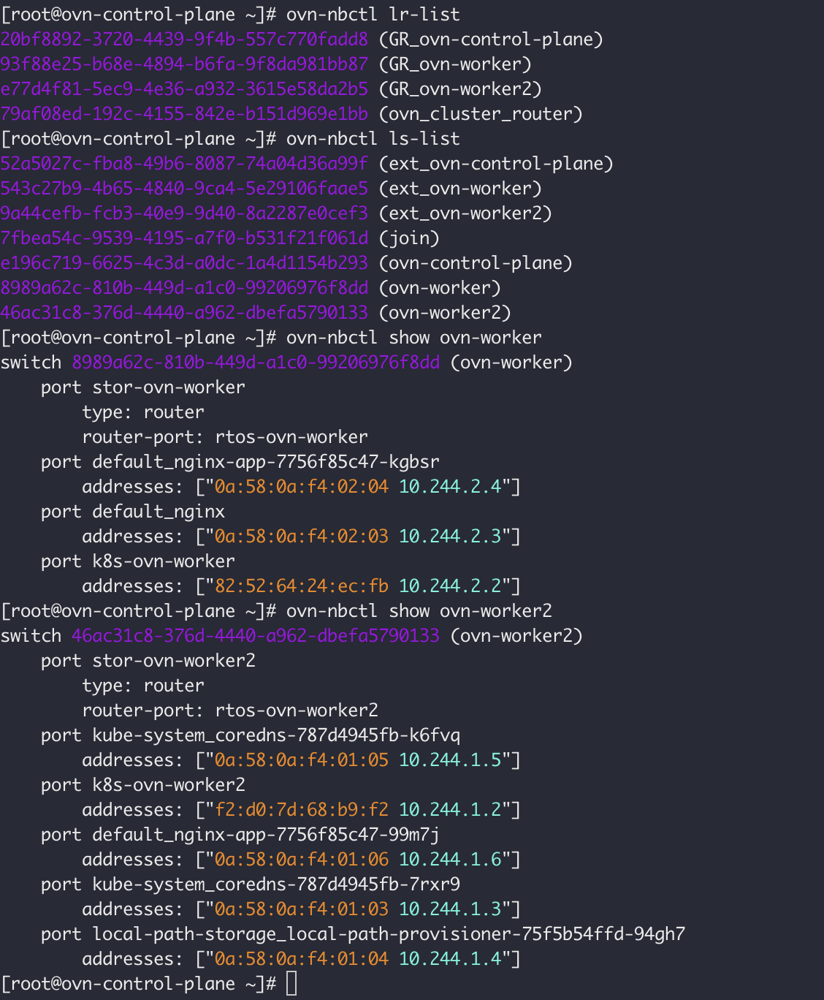
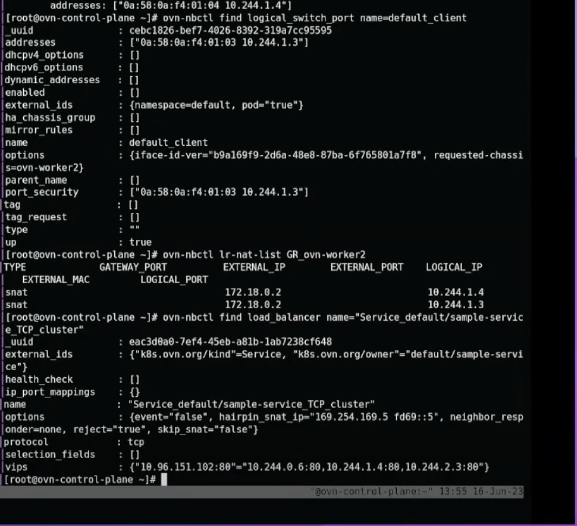
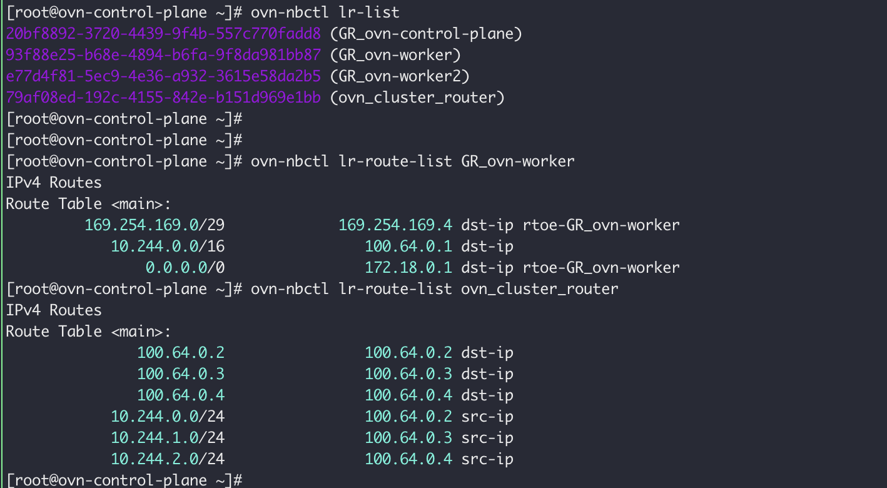
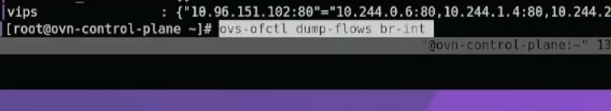
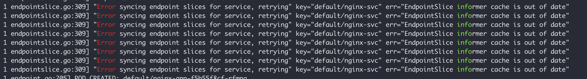
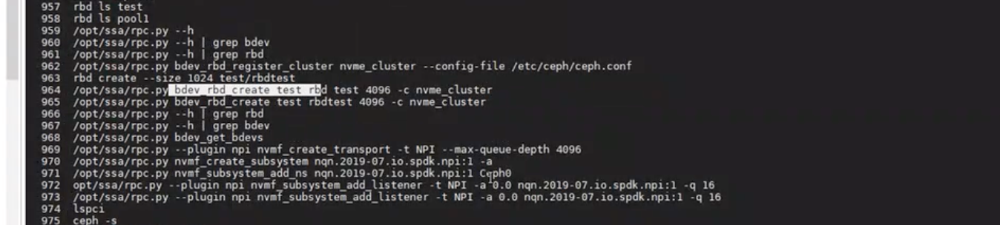

## TODO


### Storage

**Jun.**

- [x] vmware 7.0U2+ spdk + ceph
- [x] degrade 问题，multipath
- [x] Doc for IBM
- [ ] video demo: vmware 如何发现device，如何连接
- [x] 8.0 环境的支持，机器准备
- [x] no-default port test --- Done add firewall rule to permit traffic rule.

**Jul.**

- [ ] Github issue for esxi 8.0: https://github.com/spdk/spdk/issues/2993
- [ ] VAAI https://www.vmware.com/content/dam/digitalmarketing/vmware/en/pdf/techpaper/vmware-vsphere-storage-api-array-integration-white-paper.pdf
- [ ] VASA https://vdc-download.vmware.com/vmwb-repository/dcr-public/3d83e31d-62e5-4f3d-a7e1-a508c57cd25e/2452f34e-9ead-4864-bd86-0612b0d16085/VASA%20Program%20Guide%20v4.0.pdf
- [ ] IBM storage Provider for VASA https://www.ibm.com/docs/en/spectrum-connect/3.7.0?topic=environment-storage-provider-vmware-vasa


- 


### Kafka 测试

```sh
k get po -A |grep "kafka-client-job" | awk '{print $2}'| xargs -n1 kubectl logs |grep "producer-metrics"|grep "record-error-rate\|request-latency-avg\|request-latency-max\|response-rate"


k get po -A |grep "kafka-client-job" | awk '{print $2}'| xargs -n1 kubectl logs |grep "30000 records sent"


```


```sh
cat without_nn.log |grep record-error-rate

cat without_nn.log |grep request-latency-avg | awk '{print $3}'

cat without_nn.log |grep request-latency-max | awk '{print $3}'

cat without_nn.log |grep response-rate | awk '{print $3}'


k get po -A |grep "kafka-client-1-job" | awk '{print $2}'| xargs -n1 kubectl logs |grep "7200000 records sent" >  result.log 2>&1

cat result.log | awk '{print $4}' 
# 4  8 25

k get po -A |grep "kafka-client-job" | awk '{print $2}'| xargs -n1 kubectl logs |grep "20000 records sent" >  result.log

ls | grep "result.log" | xargs -n1 sh -c 'awk '\''{ sum4 += $4; sum8 += $8; sum16 += $16; sum19 += $19; sum22 += $22; sum25 += $25; count++ } END { printf "%.6f\n", sum4/count; printf "%.6f\n", sum8/count; printf "%.6f\n", sum16/count; printf "%.6f\n", sum19/count; printf "%.6f\n", sum22/count; printf "%.6f\n", sum25/count }'\'' "$@" && echo "$@\n"  "Base Only Kafka"' sh


ls | grep "3_bench" | grep -v "full"|xargs -n1 sh -c 'awk '\''{ sum4 += $4; sum8 += $8; sum16 += $16; sum19 += $19; sum22 += $22; sum25 += $25; count++ } END { printf "%.6f\n", sum4/count; printf "%.6f\n", sum8/count; printf "%.6f\n", sum16/count; printf "%.6f\n", sum19/count; printf "%.6f\n", sum22/count; printf "%.6f\n", sum25/count }'\'' "$@" && echo "$@\n"  "Kafka with IPerf 3*60M with IOI"' sh


#  full log to get avg
ls | grep "3_bench" | grep "full" | xargs -n1 sh -c "cat \$1 | grep 'records sent' | grep -v '99th' | awk '{print \$8}' | sort -n -r | sed '1,40d' | awk '{ sum += \$1 } END { print sum / NR }'" sh| awk '{ sum += $1 } END { print sum / NR }'

for ((i=1; i<=4; i++))
do
  echo "------------ 10 ioi case$i benchmark --------------------"
  kubectl apply -f fio_deployment_ioi.yaml
  sleep 20s
  kubectl apply -f kafka-job.yaml
  kubectl wait --for=condition=complete --timeout=3600s job/kafka-client-job
  kubectl get po | grep kafka-client-job

  kubectl  get po -A |grep "kafka-client-job" | awk '{print $2}'| xargs -n1 kubectl logs |grep "3600000 records sent" >  ./result/b-20m-result-10$i.log

  kubectl delete -f fio_deployment_0.yaml
  sleep 20s
  kubectl delete -f kafka-job.yaml
  kubectl delete po --all
  sleep 3m

done


  kubectl  get po -A |grep "kafka-client-1-job" | awk '{print $2}'| xargs -n1 kubectl logs |grep "7200000 records sent" >  ./result/b-20m-result-10$i.log
  
  node.kubernetes.io/disk-pressure
```


### Fio Pod

```yaml
apiVersion: apps/v1
kind: Deployment
metadata:
  name: fio-deployment
  labels:
    app: fio
spec:
  replicas: 10
  selector:
    matchLabels:
      app: fio
  template:
    metadata:
      annotations:
        blockio.kubernetes.io/container.stress.rbps: '0M/4k'
        blockio.kubernetes.io/container.stress.wbps: '5M/4k'
      labels:
        app: fio
    spec:
      containers:
        - name: con-8
          image: jadechu/simuworks:v5
          resources:
            limits:
              cpu: 200m
              memory: "200Mi"
            requests:
              cpu: 200m
              memory: "200Mi"
          imagePullPolicy: IfNotPresent
          args:
            [
              '--filename=/tmp/test',
              '--direct=0',
              '--mode=norm',
              '--time=84600,60',
              '--size=60g',
              '--rate=0m-10m,44m-40m',
              '--ioengine=sync',
              '--fdatasync=0',
              '--rw=write',
              '--bs=4k,4k'
            ]
          volumeMounts:
            - name: fio-config-vol
              mountPath: /tmp
      volumes:
        - name: fio-config-vol
          emptyDir: {}
      nodeSelector:
        kubernetes.io/hostname: ioi-2
```


### Kafka Pod

```yaml
apiVersion: batch/v1
kind: Job
metadata:
  name: kafka-client-job
  labels:
    app: kafka-client
spec:
  parallelism: 10
    # selector:
    #   matchLabels:
    #     app: kafka-client
  template:
    metadata:
      annotations:
        blockio.kubernetes.io/container.stress.rbps: '0M/4k'
        blockio.kubernetes.io/container.stress.wbps: '2M/4k'
      labels:
        app: kafka-client
    spec:
      restartPolicy: Never
      containers:
      - name: kafka-client
        env:
          - name: POD_NAME
            valueFrom:
              fieldRef:
                fieldPath: metadata.name
        image: confluentinc/cp-kafka:6.1.0
        command:
        - sh
        - -c
        - "kafka-producer-perf-test --topic $POD_NAME --throughput 20000 --num-records 3600000 --record-size 1024  --producer-props acks=all bootstrap.servers=kafka-empty-dir.default.svc.cluster.local:9092 --print-metrics"
          # - "kafka-producer-perf-test --topic $POD_NAME --throughput -1 --num-records 40000 --record-size 524288  --producer-props acks=all bootstrap.servers=kafka-empty-dir.default.svc.cluster.local:9092 --print-metrics"
      nodeSelector:
        kubernetes.io/hostname: ioi-1
```


## RocksDB test

```sh
sysbench /usr/share/sysbench/oltp_write_only.lua \
--tables=64 \
--table_size=1  \
--mysql-user=root \
--mysql-password=123456 \
--mysql-host=10.244.2.166 \
--mysql-port=3306 \
--mysql-db=rocks_demo \
--threads=10  \
prepare

sysbench /usr/share/sysbench/oltp_write_only.lua \
--tables=64 \
--table_size=10000000  \
--mysql-user=root \
--mysql-password=123456 \
--mysql-host=10.244.2.166 \
--mysql-port=3306 \
--mysql-db=rocks_demo \
--threads=50  \
--time=300 \
--report-interval=3 \
run

kafka throught
-  200M/4k


```


https://blog.51cto.com/huny/3265619

https://github.com/akopytov/sysbench

https://cloud.tencent.com/developer/article/1536046








## ClusterNet

CoreDNS multi cluster plugin

```sh

```


rocksdb


io, 调度， 控制


- 环境部署、测试
- 1-1， 控制手段单薄，磁盘建模理论支撑，核心技术点， cpu mem 剩余，io 用尽的情况
- 1-1 Aggregator， hard code，core DNS， 多实例之间的数据同步，raft 
- 工作有点散，大家各做各自的，继续之前每周介绍项目的传统


- Aggregator 为什么要同步Pod信息到 node agent
- IPU vdisk -> Pod 模型， 一个IPU有多少VF，是否可以满足，以及VF-Pod模型


[chat.openai.com/api/auth/session](https://chat.openai.com/api/auth/session)


## Rocksdb

```sh


ls | grep "rocksdb-2-fio.sh" | xargs -n1 sh -c 'awk '\''NR==11 || NR==12 || NR==13 || NR==21 || NR==22|| NR==23|| NR==24 {if (NR==11 || NR==12  ) print $2/360; else if (NR==13) print $3/360; else if (NR==24) print $3; else print $2} '\'' "$@" && echo "$@\n"  " rocksdb +  Kafka "' sh


tail -n 26 |awk ''


k get po -A |grep "kafka-client-1-job" | awk '{print $2}'| xargs -n1 kubectl logs |grep "7200000 records sent" >  result.log

ls | grep "bench-0-ioi-result-1088.log" | xargs -n1 sh -c 'awk '\''{ sum4 += $4; sum8 += $8; sum16 += $16; sum19 += $19; sum22 += $22; sum25 += $25; count++ } END { printf "%.6f\n", sum4/count; printf "%.6f\n", sum8/count; printf "%.6f\n", sum16/count; printf "%.6f\n", sum19/count; printf "%.6f\n", sum22/count; printf "%.6f\n", sum25/count }'\'' "$@" && echo "$@\n"  "Kafka 10*50M limit to 16M//4K with IOI"' sh


k get po -A |grep "1-bench-" | awk '{print $2}'| xargs -n1 kubectl logs |grep "7200000 records sent" |  sh -c 'awk '\''{ sum4 += $4; sum8 += $8; sum16 += $16; sum19 += $19; sum22 += $22; sum25 += $25; count++ } END { printf "%.6f\n", sum4/count; printf "%.6f\n", sum8/count; printf "%.6f\n", sum16/count; printf "%.6f\n", sum19/count; printf "%.6f\n", sum22/count; printf "%.6f\n", sum25/count }'\'' "$@" && echo "$@\n"  "Kafka 10*50M limit to 16M//4K with IOI"' sh


ls |grep "1-bench-"| xargs -n1 cat | sh -c 'awk '\''{ sum4 += $4; sum8 += $8; sum16 += $16; sum19 += $19; sum22 += $22; sum25 += $25; count++ } END { printf "qps: \t %.6f\n", sum4/count; printf "avg_latency: \t%.6f\n", sum8/count; printf "p50_latency \t %.6f\n", sum16/count; printf "p95_latency: \t %.6f\n", sum19/count; printf "p99_latency: \t %.6f\n", sum22/count; printf "p999_latency: \t %.6f\n", sum25/count }'\'' "$@" && echo "$@\n"  "Kafka Producer performance metrics"' sh
```


文件系统类型

不同类型的块文件系统，不同的调度算法

怎么确定burst 了

Jbd2 文件系统的影响 随机写jbd 大

sbtes

- Aggregator API 
- 


```sh
SHOW VARIABLES LIKE 'default_storage_engine%';
SET default_storage_engine=RocksDB;
SHOW CREATE TABLE table_name;
```


=


周四 1-1 准备OKR 和 Insight 

多磁盘的使用，如何用，然后才考虑如何调度

网络Limit ，如果client 和 server 都调度在了同一个节点上， quota如何计算？

VXLAN Overlay Network 场景下不可以用


启动或者禁用adq

```sh
rmmod irdma; rmmod ice; sleep 2; modprobe ice
```


Adq 设置

```sh
sudo adqsetup --verbose create [globals] dev ens160 priority skbedit [GA] queues 6 pollers 6 min_rate 800 [BE] queues 6 pollers 6
```


How to enter pod namespace.

```sh
# Get all pods of a specific node
#kubectl  get po --field-selector=spec.nodeName="fluffy-master" --all-namespaces
kubectl get --all-namespaces po --field-selector=spec.nodeName=="$(hostname)" -o json | jq -r '.items[] | select(.status.hostIP!=.status.podIP) | "\(.metadata.name) \(.metadata.namespace)"'
 
# Get the Pod ID of the Pod with crictl
POD_ID=$(sudo crictl pods --name=${POD_NAME} --namespace=default -q --no-trunc)
 
# Get the network namespace of this pod
NETNS=$(sudo crictl inspectp ${POD_ID} | jq -r '.info.runtimeSpec.linux.namespaces[] |select(.type=="network") | .path')
 
# Jump into the network namespace and execute something
sudo nsenter --net=${NETNS} ip a
 
 
 
或者找到pod的pid 可以用sudo nsenter -t <PID> -n  <command>
 
 
${pathtotc}/tc qdisc add dev $iface root mqprio num_tc 2 map 0 1 1 0 1 1 1 1 queues \
$num_queues_tc0@0 $num_queues_tc1@$num_queues_tc0 hw 1 mode channel  shaper bw_rlimit min_rate 500Mbit 100Mbit
 
     0 1 1 0 1 1 1 1 0 0 0 (tc)
 
idx  0 1 2 3 4 5 6 7 8 9 10 (prio)
```


查看是否启动了adq

```sh
sud

## 查看流量是否走了adq
watch -d -n 0.5 "ethtool -S ens160 | grep busy | column" 
```


什么是tc, 

```sh
 tc qdisc show dev ens160
```

tc 一般是单向限制， Ingress把流量导到ifb， 在ifb上限流。 另外一个是在veth 的host端做tc

```sh
sudo tc filter show dev ens160 ingress
sudo tc filter show dev ens160 egress
```


Install ADQ in ubuntu

[ADQ Installation on Ubuntu (22.04 Kernel 15.5) - DCG DNSG Software Container Team - Intel Enterprise Wiki](https://wiki.ith.intel.com/pages/viewpage.action?pageId=2765156312)

```sh
# adq download
wget https://sourceforge.net/projects/e1000/files/ice%20stable/1.10.1.2/ice-1.10.1.2.tar.gz/download

# adq enable 
sudo su; rmmod irdma; rmmod ice; sleep 2; modprobe ice

sudo make -j4 CFLAGS_EXTRA='-DADQ_PERF_COUNTERS' install

modinfo ice

# adq version check
cat /sys/class/net/ens160/device/driver/module/drivers/pci:ice/module/version
```


Test data statistics

```sh
ls | grep "1_bench" | grep -v "full"|xargs -n1 sh -c 'awk '\''{ sum4 += $4; sum8 += $8; sum16 += $16; sum19 += $19; sum22 += $22; sum25 += $25; count++ } END { printf "%.6f\n", sum4/count; printf "%.6f\n", sum8/count; printf "%.6f\n", sum16/count; printf "%.6f\n", sum19/count; printf "%.6f\n", sum22/count; printf "%.6f\n", sum25/count }'\'' "$@" && echo "$@\n"  "Kafka with IPerf 3*60M  "' sh


#  full log to get avg
ls | grep "4_bench" | grep "full" | xargs -n1 sh -c "cat \$1 | grep 'records sent' | grep -v '99th' | awk '{print \$8}' | sort -n -r | sed '1,40d' | awk '{ sum += \$1 } END { print sum / NR }'" sh| awk '{ sum += $1 } END { print sum / NR }'
```


```sh
# old version

ls | grep "bench-ga-kafka-otherga-without-ioi" |xargs -n1 sh -c 'awk '\''{ sum4 += $4; sum8 += $8; sum16 += $16; sum19 += $19; sum22 += $22; sum25 += $25; count++ } END { printf "%.6f\n", sum4/count; printf "%.6f\n", sum8/count; printf "%.6f\n", sum16/count; printf "%.6f\n", sum19/count; printf "%.6f\n", sum22/count; printf "%.6f\n", sum25/count }'\'' "$@" && echo "$@\n"  "Kafka  with other 3*Kafka "' sh


```


Todo:

BE get more, does GA will snatch the resources 


1. 跟我们现有的方案如何结合
2. 是否与Vdisk的方案相互冲突


写放大  的问题？


### Questions


1. **Kafka Capacity**  700M     -> 

   **Mysql Capacity**  200M  ???

​      随机写： 230MB？ 600M(profile 方式存在问题)     最大随机写 320MB

​      顺序写： > 1000MB 


Capacity:  200MB/4k  profile tools value


2. Kafka without IOI,  Kafka-1 的影响不明显。 且相同Noisy Neighbor 下对Kafka-1的影响不同。 disk 表现不同。

3. Mysql 写放大的问题，80M -> 130M   只要有一点 Noisy Neighbor就会影响 Bandwidth.
   - 空间放大（Space Amplification）。因为所有的写入都是顺序写（append-only）的，不是 in-place update ，所以过期数据不会马上被清理掉。
   - 应用的原因， 应用写1M 实际写盘 > 1M.


application : 80M  ->    130M


Capacity GA PooL:   800M/32k  

RocksDB  -> request 200M/4k

Kafka-2:   160M/4k    10%

Kafka-3:   400M/4k    50%


AI workload










​                 











```sh
./kind.sh -ds
```





```shell
自动多机部署脚本

网卡的Queue 的数量， > Queue 的数量才会出现竞争关系i。每个Queue的力是怎样的。
```


