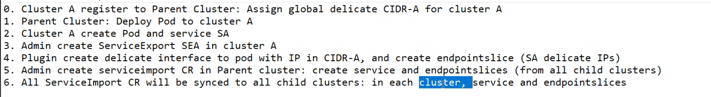
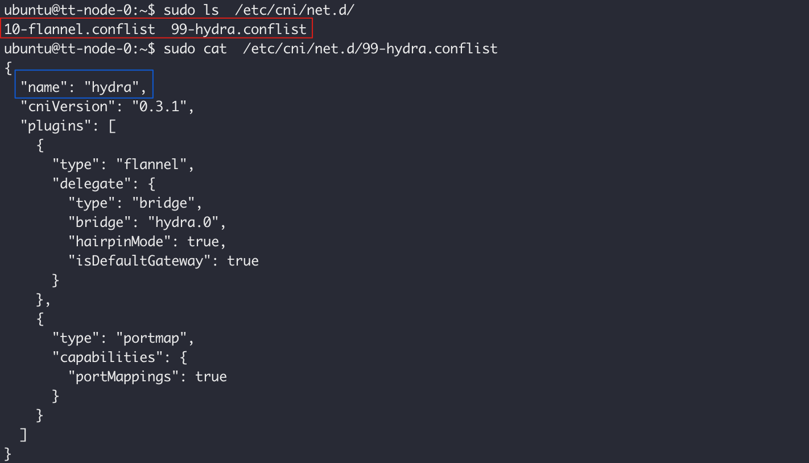

Leverage NRI to create a cross cluster parallel network without overlap.


>- Whether to create a parallel network for all pods by default？
>
>​      默认不加parallel network
>
>- cross-cluster service initiator need parallel network？

1. Create a deployment and service, and use annotations to indicate whether this service is a `cross-cluster service`. 

   the annotation contains which network interface(by `cni-config-name`) will be used for the Pod to expose to other clusters.

   

```yaml
apiVersion: v1
kind: Service
metadata:
  name: my-service
  annotation: 
    mcs.kubernetes.io/cross-cluster: hydra # true/ or specify a cni-config-name
spec:
  selector:
    app.kubernetes.io/name: MyApp
  ports:
    - protocol: TCP
      port: 80
      targetPort: 9376
```

2. Dedicated CNI plugin Create a new network for the Pod of the service with cross-cluster label by the `cni-config-name`.

3. Create/update a endpointslice based on the IP of the POd parallel network, the name patern is `<cni-config-name>-<service-name>`. pod delete remove the IP in endpoitslice.

   ```yaml
   apiVersion: discovery.k8s.io/v1
   kind: EndpointSlice
   metadata:
     name: hydra-my-service
     labels:
       mcs.kubernetes.io/cross-cluster-service: my-service
   addressType: IPv4
   ports:
     - name: http
       protocol: TCP
       port: 80
   endpoints:
     - addresses:
         - "10.1.2.3"
         - "10.1.2.4"
   
   ```

   


TODO:

- [ ] endpoint management， when delete pod how to update the endpoint
- [ ] endpoint slice management 


## Enalbe  MultiCIDR 

### Kubernetes

[MulltiClusterCIDR KEP](https://github.com/kubernetes/enhancements/tree/master/keps/sig-network/2593-multiple-cluster-cidrs)

- `MultiCIDRRangeAllocator`: Enables the MultiCIDR range allocator.
- `MultiCIDRServiceAllocator`: Track IP address allocations for Service cluster IPs using IPAddress objects.


### Flannel 

https://github.com/flannel-io/flannel/issues/1564


https://github.com/flannel-io/flannel/pull/1658
