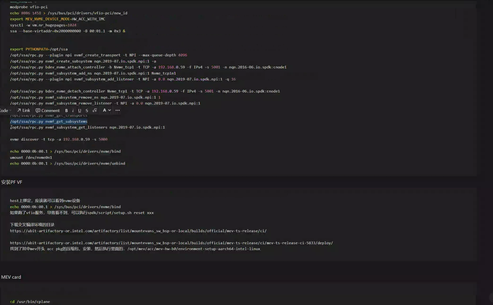
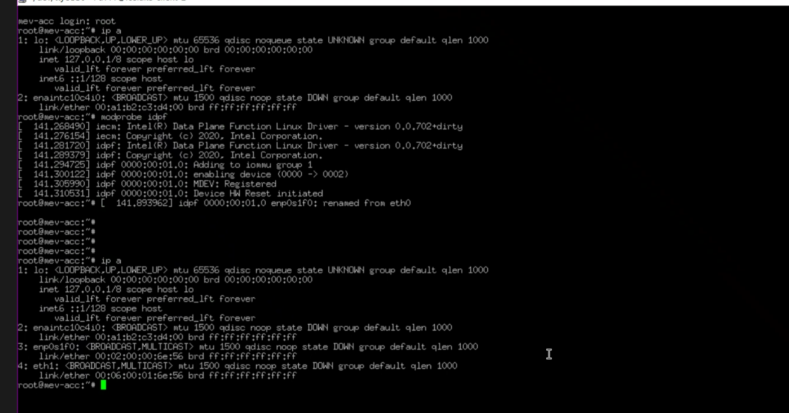
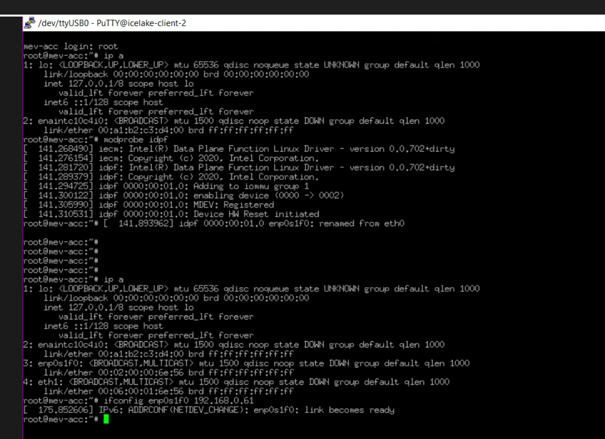
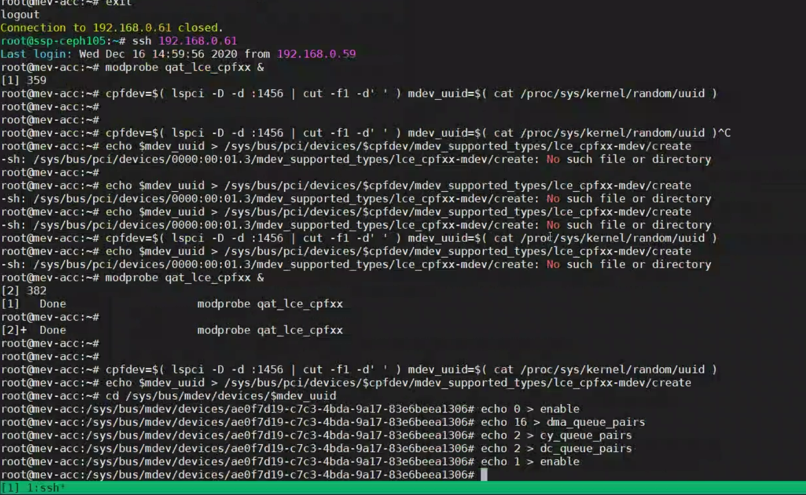
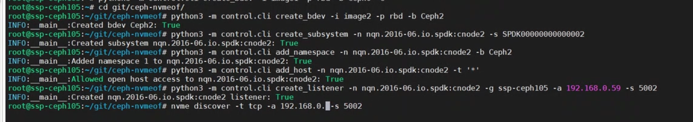
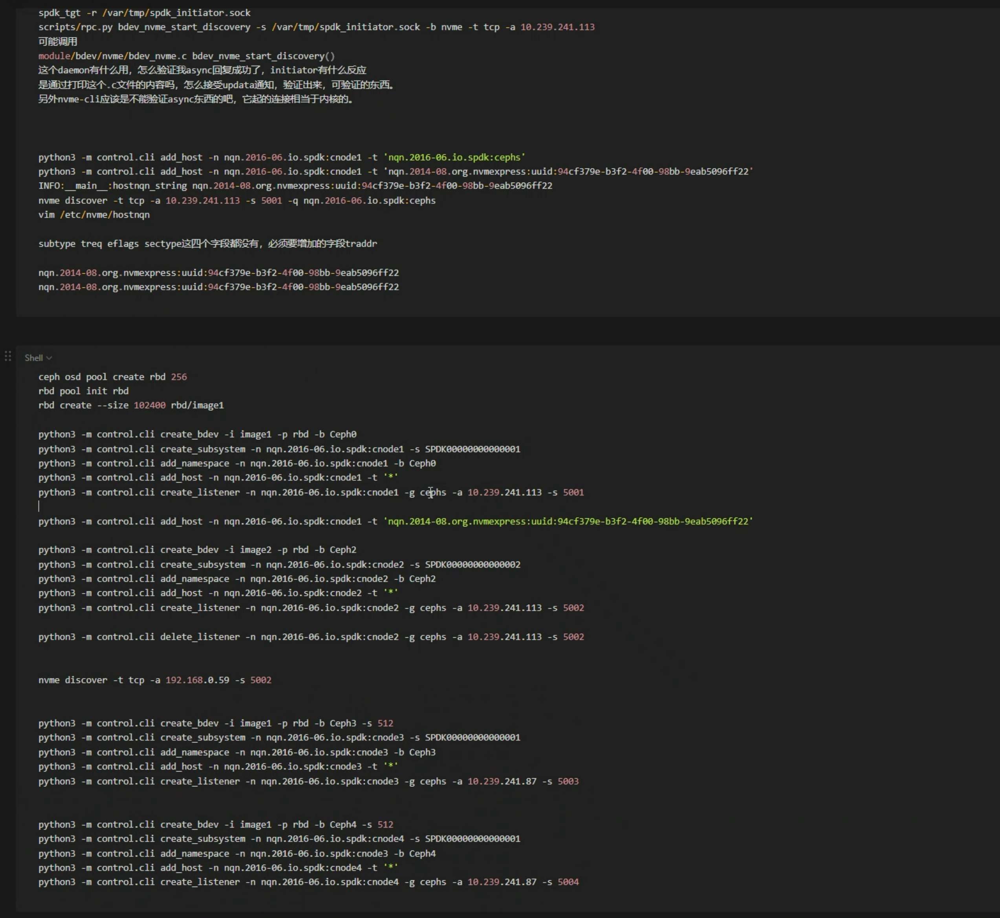

## IPDK

https://blog.csdn.net/Jmilk/article/details/125499049#:~:text=IPDK%EF%BC%88Infrastructure%20Programmer%20Development%20Kit,Switch%20%E6%9E%84%E5%BB%BA%E7%9A%84%E5%9F%BA%E7%A1%80%E8%AE%BE%E6%96%BD%E3%80%82


https://zhuanlan.zhihu.com/p/590316444


NVMe command


```shell
nvme discover -t tcp -a 192.168.0.57 -s 5001


nvme discover -t tcp -a 10.0.0.111 -s 5001

nvme connect -t tcp -n  nqn.2016-06.io.spdk:cnode1 -a  10.239.241.168 -s 5001 --hostnqn=nqn.2016-06.io.spdk:cnode1


10.239.241.168 -s 4420

 nvme disconnect /dev/nvme0n1 -n  nqn.2016-06.io.spdk:cnode1
```


一个target 是否可以被两个nvme client 连接

NRI allows plugging domain- or vendor-specific custom logic into OCI-compatible runtimes. This logic can make controlled changes to containers or perform extra actions outside the scope of OCI at certain points in a containers lifecycle. 


- IPU 测试
- Kubecon 环境的准备以及Video
- Clusternet CNI, NRI CNI 

## SPDK


Fio write full disk

```shel
```


Create a rbd

````sh
rbd -p rbd ls
# 【方式一】创建块设备
rbd create rbd/directly-rbd.img --size 100G
````












#############################


```sh
# 4K
# 4K %0 Read
./build/examples/bdevperf -q 128 -o 4096 -w randrw -M 0 -t 60 -m 0x1 -k 0 -C -z
# 4K 50% Read
./build/examples/bdevperf -q 128 -o 4096 -w randrw -M 50 -t 60 -m 0x1 -k 0 -C -z
# 4K 70% Read
./build/examples/bdevperf -q 128 -o 4096 -w randrw -M 70 -t 60 -m 0x1 -k 0 -C -z
# 4K 100% Read
./build/examples/bdevperf -q 128 -o 4096 -w randrw -M 100 -t 60 -m 0x1 -k 0 -C -z

# 16K
# 16K %0 Read
./build/examples/bdevperf -q 128 -o 16384 -w randrw -M 0 -t 60 -m 0x1 -k 0 -C -z
# 16K 50% Read
./build/examples/bdevperf -q 128 -o 16384 -w randrw -M 50 -t 60 -m 0x1 -k 0 -C -z
# 16K 70% Read
./build/examples/bdevperf -q 128 -o 16384 -w randrw -M 70 -t 60 -m 0x1 -k 0 -C -z
# 16K 100% Read
./build/examples/bdevperf -q 128 -o 16384 -w randrw -M 100 -t 60 -m 0x1 -k 0 -C -z


# 4M
# 4M %0 Read
./build/examples/bdevperf -q 128 -o 4194304 -w randrw  -M 0 -t 60 -m 0x1 -k 0 -C -z
# 4M 50% Read
./build/examples/bdevperf -q 128 -o 4194304 -w randrw  -M 50 -t 60 -m 0x1 -k 0 -C -z
# 4M 70% Read
./build/examples/bdevperf -q 128 -o 4194304 -w  randrw -M 70 -t 60 -m 0x1 -k 0 -C -z
# 4M 100% Read
./build/examples/bdevperf -q 128 -o 4194304 -w  randrw -M 100 -t 60 -m 0x1 -k 0 -C -z

[global]
iodepth=128
rw=randrw
cpumask=0x1 

[4k-0-read]
bs=4096
rwmixread=0

[4k-50-read]
bs=4096
rwmixread=50

[4k-70-read]
bs=4096
rwmixread=70

[4k-100-read]
bs=4096
rwmixread=0


./build/examples/bdevperf -q 128 -o 4096 -w randwrite -M 0 -t 30 -m 0x1 -k 0 -C -z

./scripts/rpc.py bdev_rbd_register_cluster nvme_cluster --config-file /etc/ceph/ceph.conf&& \
./scripts/rpc.py bdev_rbd_create rbd image1 4096 -c nvme_cluster && \
PYTHONPATH=$PYTHONPATH:./python/ examples/bdev/bdevperf/bdevperf.py perform_tests

```


### CephNVMe of  Create a target

```sh
python3 -m control.cli create_bdev -i image1 -p rbd -b Ceph0

python3 -m control.cli create_subsystem -n nqn.2016-06.io.spdk:cnode1 -s SPDK00000000000001

python3 -m control.cli add_namespace -n nqn.2016-06.io.spdk:cnode1 -b Ceph0

python3 -m control.cli add_host -n nqn.2016-06.io.spdk:cnode1 -t '*'

python3 -m control.cli create_listener -n nqn.2016-06.io.spdk:cnode1 -g cephs -a 10.239.241.113 -s 5001

python3 -m control.cli create_listener -n nqn.2016-06.io.spdk:cnode1 -g icelake-server-3 -a 192.168.0.57 -s 5001
```


DPDK

https://developer.aliyun.com/article/941480


DPDK的IPC 不是特别高

