## ESXI env

Vsphere： https://cre-vsphere.sh.intel.com/

user: administrator@cre-vsphere.sh.intel.com  passwd: CREshare123-


lshw -c network -businfo


```sh
lshw -c network -businfo
```


## ESXI   NVME TCP


IBM exsi nvme

https://www.ibm.com/docs/en/flashsystem-9x00/8.6.x?topic=nhtrveos-configuring-vmware-esxi-operating-system-nvme-over-rdma-nvme-over-tcp-hosts-2


esxi 7 with nvme: 

https://www.codyhosterman.com/2020/05/is-nvme-of-ready-for-prime-time-with-vsphere-7/


**ESXI NVME of till now** 

https://docs.vmware.com/cn/VMware-vSphere/8.0/vsphere-storage/GUID-813AB86B-F54D-420A-98FC-787C54D0E37A.html#GUID-813AB86B-F54D-420A-98FC-787C54D0E37A


License

https://www.iyio.net/2022/11/071755.html


## ESXI 7.0 NVME over TCP

### Step by step

##### COMMAND

##### configure multipath


https://kb.blockbridge.com/guide/vmware-nvme-tcp/

https://kb.blockbridge.com/guide/vmware-nvme-tcp/#connect-to-nvmetcp-storage

https://kb.blockbridge.com/guide/vmware-nvme-tcp/#discovery

https://kb.blockbridge.com/guide/vmware-nvme-tcp/


https://docs.vmware.com/en/VMware-vSphere/7.0/com.vmware.vsphere.storage.doc/GUID-85B8E157-42B7-4532-8224-FFCA81072EC7.html

enable nvme over TCP

https://kb.vmware.com/s/article/1003872

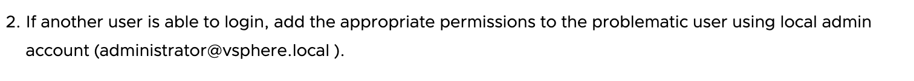


1. Create VMkernel bind adapter

   https://docs.vmware.com/en/VMware-vSphere/7.0/com.vmware.vsphere.storage.doc/GUID-CC0E6C61-C297-42C7-8ACF-CA4195F23103.html


why linux nvme target doesn't supprt VMware

https://koutoupis.com/2022/04/22/vmware-lightbits-labs-and-nvme-over-tcp/


Nvme over tcp for VMware

https://www.lightbitslabs.com/vmware/


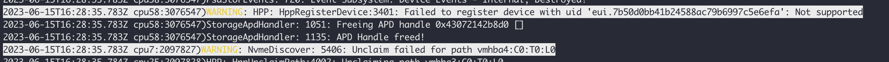


## Linux NVMe target

https://blog.csdn.net/qq_39690706/article/details/122089611

https://blog.csdn.net/qq_39690706/article/details/122089611

## SPDK

````sh
apt-get install librados-dev librbd-dev
git clone https://github.com/spdk/spdk.git 
cd /home/spdk/ 
git submodule update --init 
scripts/pkgdep.sh 
./configure --with-rbd --enable-debug   
make -j 8 
./scripts/setup.sh # 设置大页 


./build/bin/nvmf_tgt -m 0x1 -L nvmf -L nvmf_tcp
````


```sh
./scripts/rpc.py nvmf_create_transport -t TCP -m 32 -i 1048576 -u 131072 

#./scripts/rpc.py construct_nvme_bdev -b nvme0 -t PCIe -a 0000:5e:00.0 

#./scripts/rpc.py construct_nvme_bdev -b nvme0 -t PCIe -a 0000:d8:00.0 

./scripts/rpc.py bdev_aio_create /home/ziyeyang/image_test.file aio0 4096 

./scripts/rpc.py nvmf_create_subsystem nqn.2019-02.io.spdk:cnode1 -a -s spdk0001 

./scripts/rpc.py nvmf_subsystem_add_ns nqn.2019-02.io.spdk:cnode1 aio0 

./scripts/rpc.py nvmf_subsystem_add_listener nqn.2019-02.io.spdk:cnode1 -t TCP -a 10.239.241.61 -s 4420 


./build/examples/identify -r 'trtype:TCP adrfam:IPv4 traddr:10.239.159.133 trsvcid:4420'
```


```sh
 dd if=/dev/zero of=aio_test bs=512 count=204800k
 
  dd if=/dev/zero of=aio_1 bs=512 count=102400k
  dd if=/dev/zero of=aio_2 bs=512 count=102400k
```


## README


 vSphere Client is required for add software NVMe adaptors to ESXi.

### 1.Configure VMkernel Binding for the NVMe over TCP Adapter with a vSphere standard switch.

a. In the vSphere Client, select your host and click the **Networks** tab. Click **VMkernel Adapters**> **Add Networking**.

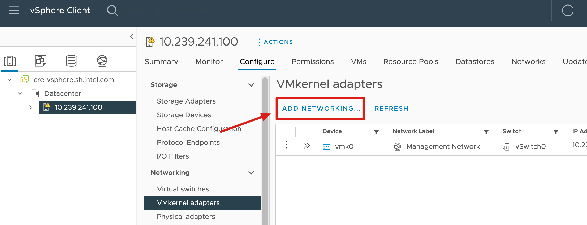

b. Select **VMkernel Network Adapter** and click **NEXT**.

c. Select **New standard switch** which connect to one of the phycical NIC and click **NEXT**.

d. Specifiy a **NetworkLale**,and enable **NVMe Over TCP** and click **NEXT**.

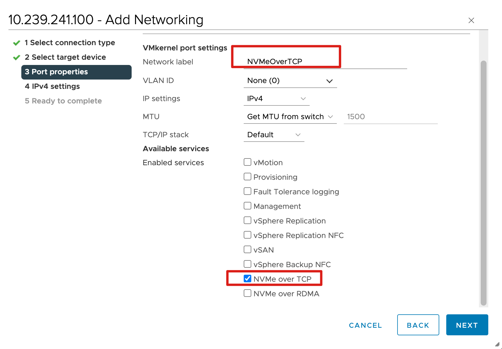

e. Select a way to get IPv4 Address, then **Finish**. And you'll see VMkernel adapters list add a new line.

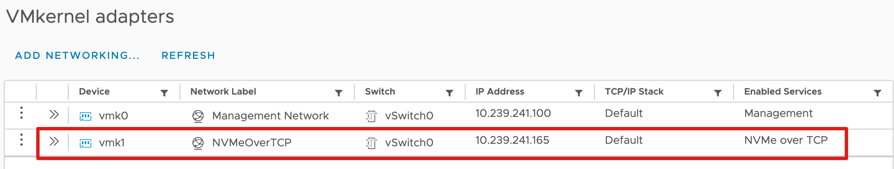

f. Verify that you switch is correctly configured. On **Configure** Tab, select **Virtual Switches** under **Netwroking**.

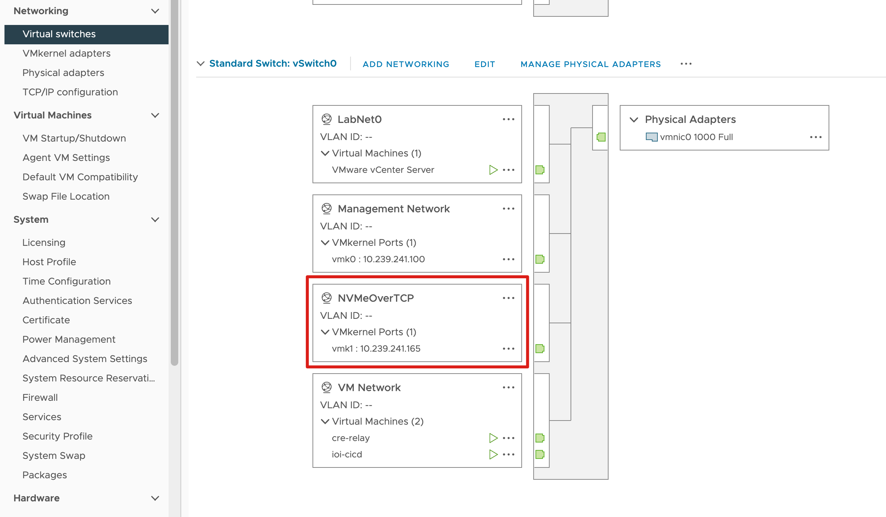


### 2.Add Software Nvme Adapters

a. Click the **Configure** tab, Under **Storage**,click **Storage Adapters**, and click the **Add Software Adapter**.

b. Select **Add NVMe over TCP adapter**, and select a physical NIC the beforce switch binded.

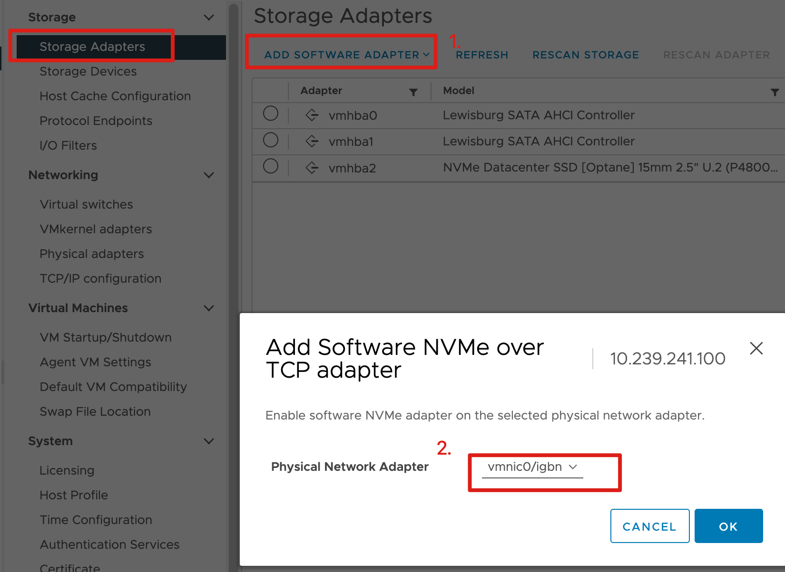

c. After that, the **Storage Adapters** List will increase a new line.

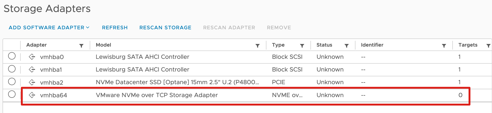

### 3.Add Controller by vSphere Client	

a. Click the **Configure** tab. Under **Storage**, click **Storage Adapters**, and select the adapter (vmhba#) to configure.

b. Click the **Controllers** tab, and click **Add Controller**.

c. Input the **IP** and **Port** Number in the dialogbox, and then click **Discover Controllers**. And then Select one of the controller you want to connect and click **OK**.

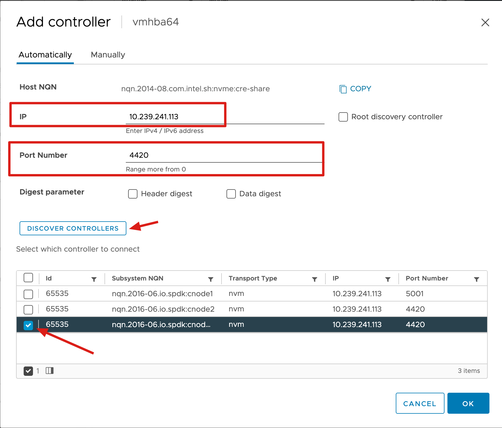

d. Verify the result.

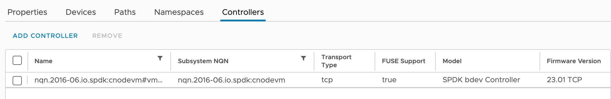

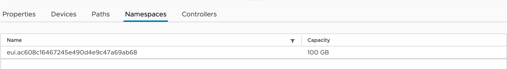

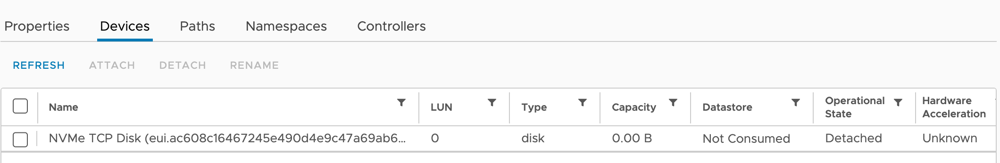

e. Check from the Storage Devices. Click **Storage Devices** under **Storage**.

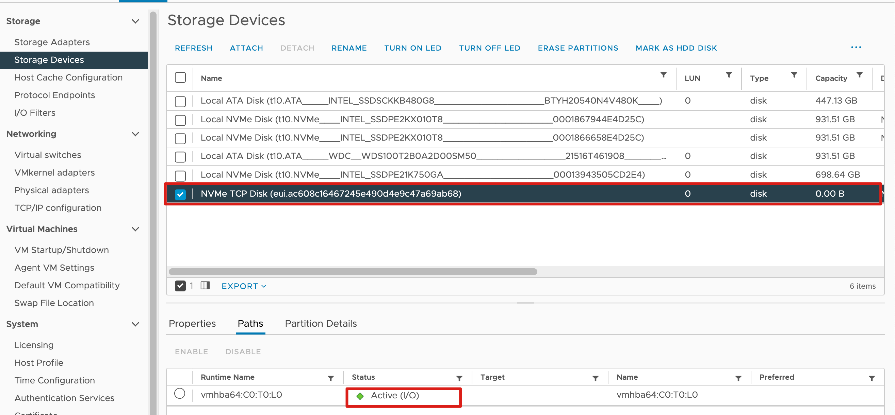


### 4.Create a new datasore from the NVMe Over TCP Disk

a. From ESXi, create a new datastore from the NVMe over TCP Disk. Under **Storage**, click **Datastoras**, and click **New datastores**, slecect **NVMe TCP disk**.

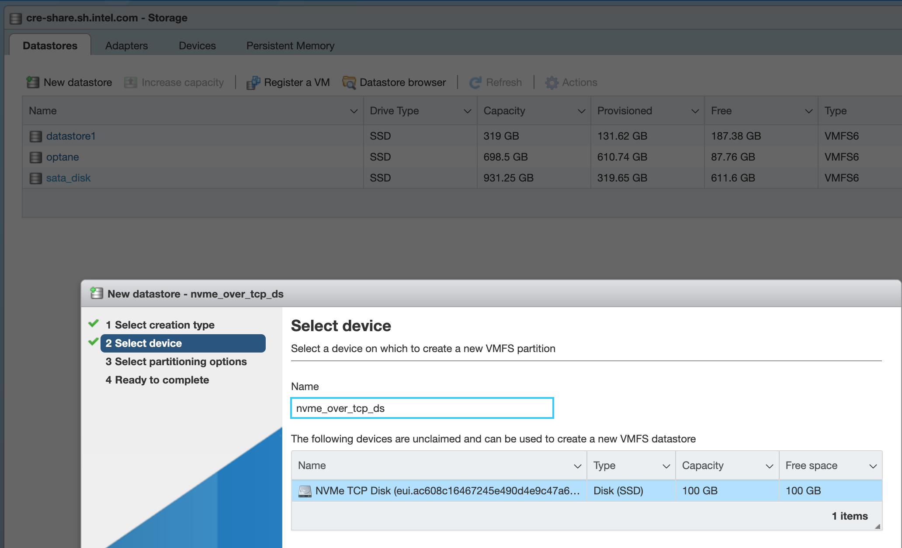

b. Check Datastore status.

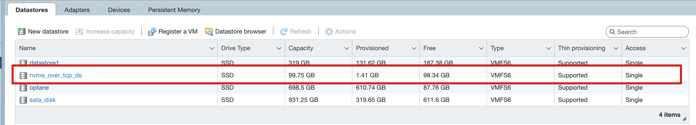


### 5.Create a VM from the NVMe TCP Datastore and Test performance by fio

a.Create a new virtual machine, use the NVMe TCP as the default disk.

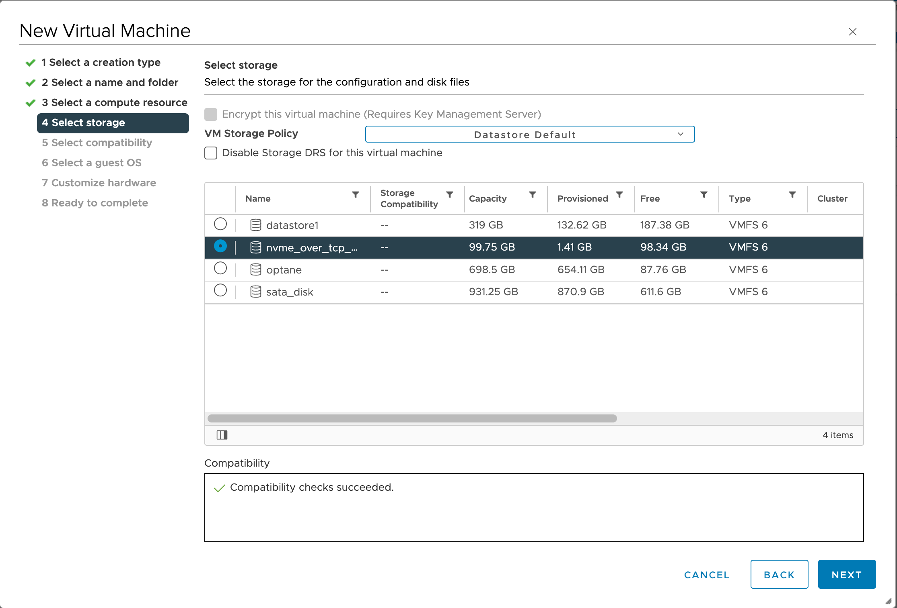

b.Start the VM an install the OS.

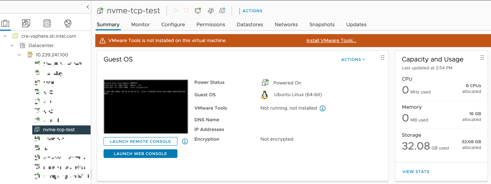

c. Test performance by fio.

```sh
fio -ioengine=libaio -bs=4k -direct=1 -thread -rw=write -size=10G -filename=/tmp/test11  -iodepth=8 -runtime=30
```

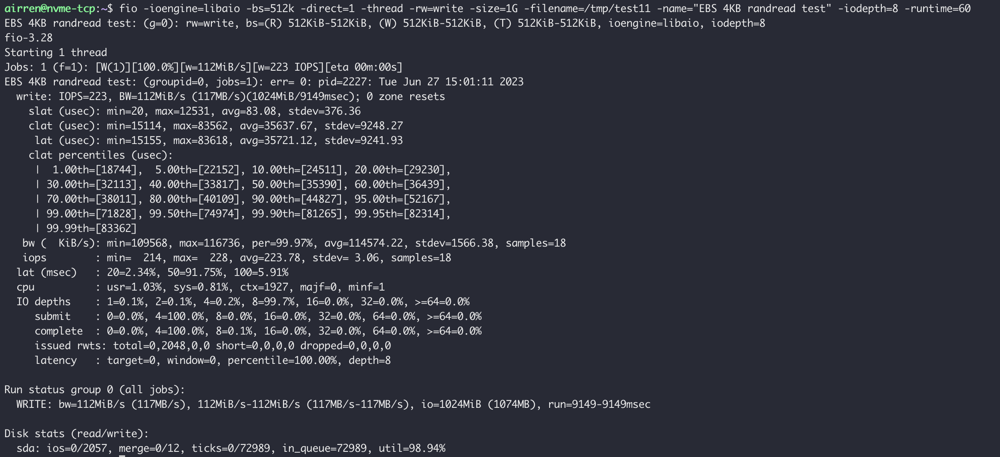

d. Check the network status.

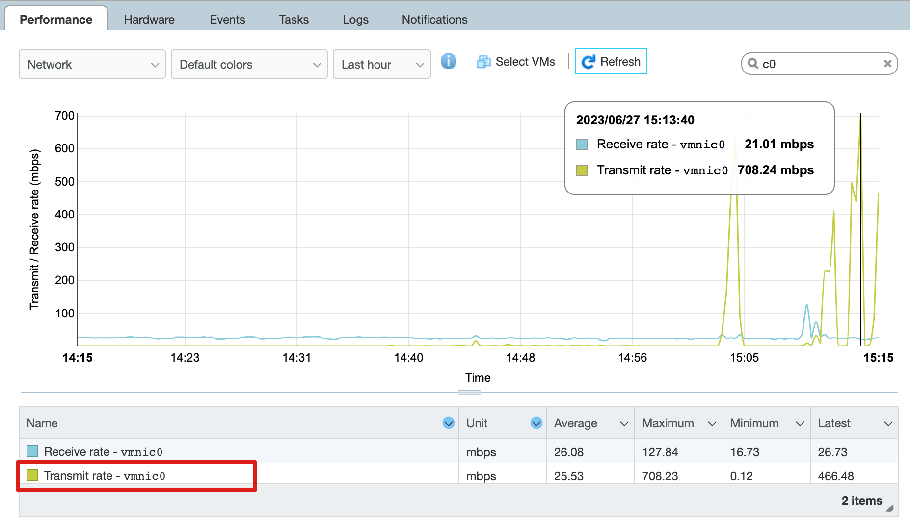


If you are not using the default port for Nvme Over TCP, please adjust the firewall rules to permit traffic to the specified Nvme TCP target port.https://docs.vmware.com/en/VMware-vSphere/7.0/com.vmware.vsphere.security.doc/GUID-9C6D29E6-C58D-4102-9FBA-DC1723E18FE9.html

Reference

1.[Configure VMkernel Binding for the TCP Adapter with a vSphere Standard Switch](https://docs.vmware.com/en/VMware-vSphere/8.0/vsphere-storage/GUID-D047AFDD-BC68-498B-8488-321753C408C2.html#GUID-D047AFDD-BC68-498B-8488-321753C408C2)


## What is Nvme-oF

https://www.storagereview.com/review/nvme-nvme-of-background-overview


## Ceph 基本概念

https://www.cnblogs.com/hukey/p/12588436.html


## VMWare 	

https://developer.aliyun.com/article/536445

**

- [ ] Github issue for esxi 8.0: https://github.com/spdk/spdk/issues/2993
- [ ] VAAI https://www.vmware.com/content/dam/digitalmarketing/vmware/en/pdf/techpaper/vmware-vsphere-storage-api-array-integration-white-paper.pdf
- [ ] VASA https://vdc-download.vmware.com/vmwb-repository/dcr-public/3d83e31d-62e5-4f3d-a7e1-a508c57cd25e/2452f34e-9ead-4864-bd86-0612b0d16085/VASA%20Program%20Guide%20v4.0.pdf
- [ ] IBM storage Provider for VASA https://www.ibm.com/docs/en/spectrum-connect/3.7.0?topic=environment-storage-provider-vmware-vasa

## VAAI

https://www.szsandstone.com/technical/article/44.html

https://core.vmware.com/resource/vmware-vsphere-apis-array-integration-vaai

https://core.vmware.com/api/checkuseraccess?referer=/sites/default/files/resource/vmware_vsphere_apis_array_integration_vaai_noindex.pdf

https://kb.vmware.com/s/article/1021976?lang=zh_CN

VMware vSphere Storage API- Array Integration(VAAI)是ESXi4.1加入的一个硬件加速功能，可以让主机将特定的虚拟机和存储管理卸载(offload)到兼容的存储阵列中。在存储阵列的帮助下，主机执行这些操作起来会更快，同时能节省CPU/内存和存储网络带宽资源，极大的改进storage-intensive operation的性能。

VAAI的目的是将部分存储操作卸载到存储阵列。例如虚拟机的克隆与迁移，传统方式是使用VMware所在的Host上的CPU以及内存完成数据的迁移与搬运，VAAI则是将这部分工作下沉到存储阵列，可以大大减轻Host的CPU以及内存压力。如果VMware使用的是网络存储，同时还降低了对网络资源的要求


### Features

VAAI 的主要功能包括：

- FULL COPY: 针对虚拟文件复制场景，把数据复制工作卸载到存储阵列中。
- BLOCK ZERO:  针对创建虚拟机磁盘格式化清零场景，避免大量的写零操作。
- Hardware-Assisted Locking(ATS): VMFS作为多主机共享的集群文件系统，需要通过加锁来避免冲突。VMware通过ATS锁细化了锁的粒度，提高了VMFS的IO并发能力。
- Tin Provisioning UNMAP: 针对存储精简配置场景进行空间回收以减少空间使用。


#### FULL COPY			

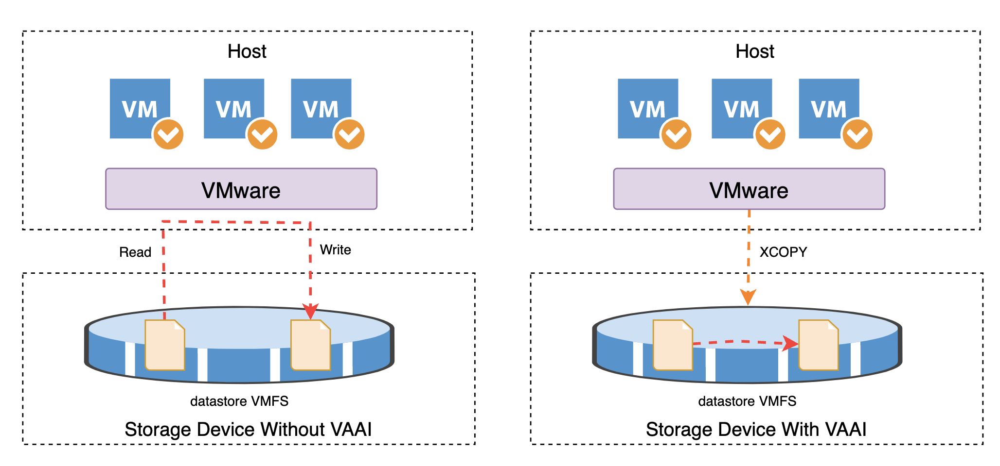

FULL COPY复制操作会在下发的SCSI `XCOPY`命令中直接携带了待复制数据的源、目的地址，底层存储系统直接基于SCSI `XCOPY`中的信息进行数据复制，这样避免了在ESXI主机侧的数据COPY，减少了IO路径，提高了数据复制的效率。

- 克隆和迁移虚拟机都可以触发full copy

#### BLOCK ZERO

传统方式对虚拟磁盘格式化是通过SCSI WRITE命令来实现，这样VMware就需要通过Write命令下发整个虚拟磁盘大小的零数据，就是要执行所有磁盘空间的写0操作。

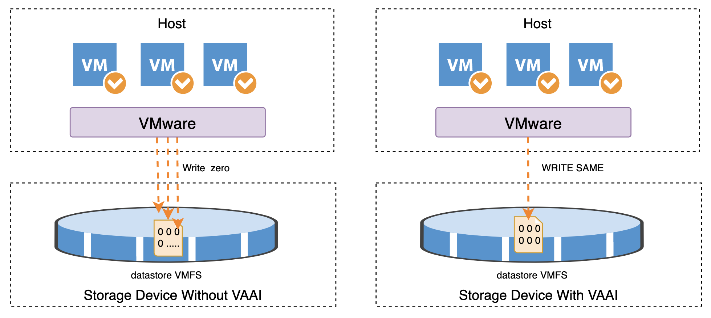

支持VAAI Block ZERO的存储系统，VMware通过下发一个WRITE SAME的SCSI命令来进行虚拟磁盘的格式化，改命令携带格式化的数据范围和格式化的数据模板，这样避免下发大量的置零数据。

- 创建虚拟机磁盘


#### ATS

VMFS作为一个集群文件系统，在多个虚拟机进行共享访问时，需要通过锁机制来避免写冲突。传统的方式通过下发SCSI `Reservation`磁盘锁命令，把整个虚拟磁盘(LUN)锁住，这样其他的虚拟机就不能访问，只能等待，因此存在并发瓶颈。


VMFS在每个虚拟机写磁盘的时候，不是对整个的VMFS LUN加锁，而是只针对写的单个数据块进行加锁。这样缩小了锁的粒度，提高了VMFS系统的并发IO，性能自然也就得到了提高。

- 批量上下电虚拟机，批量创建虚拟机

#### UNMAP

Thin Provisioning UNMAP主要是针对Thin分配的LUN做空间回收，提高存储空间的使用效率。一般应用在删除一个虚拟机文件的场合， VMware 向存储发送一个UNMAP的SCSI命令，存储就释放相应的空间。在vSphere5.0以前，只能通过写零的方式，由后端存储刀座全零的写操作而回收相应的空间。现在可以通过UNMAP命令直接回收存储空间，不用写零。

- 删除虚拟机文件的场景


### Check VAAI Status

在VMware中使用命令查看下存储支持的VAAI特性：

```sh
esxcli storage core device vaai status get 
```

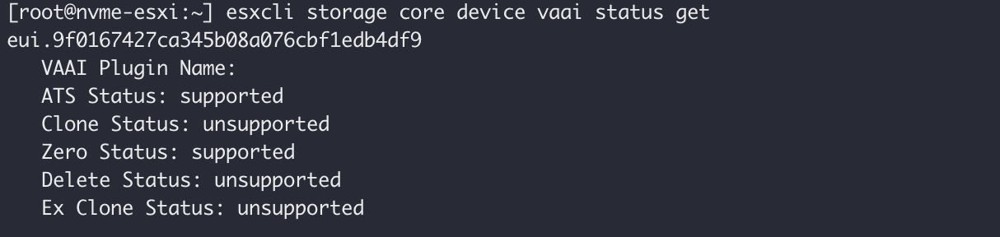


| Status          | Feature Name              | Command    |
| --------------- | ------------------------- | ---------- |
| ATS Status      | Hardware Assisted Locking | ATS        |
| Clone Status    | Full Copy                 | XCOPY      |
| Zero Status     | Block Zero                | WRITE_SAME |
| Delete Status   | UNMAP                     | UNMAP      |
| Ex Clone Status | ?                         |            |

#### ATS

```sh
 # check status
 esxcli system settings advanced list --option /VMFS3/HardwareAcceleratedLocking
 # disable 
 esxcli system settings advanced set --int-value 0 --option /VMFS3/HardwareAcceleratedLocking

```

XCOPY

```sh
 # check status
 esxcli system settings advanced list --option /DataMover/HardwareAcceleratedMove
```

WRITE_SAME

```sh
# check status
 esxcli system settings advanced list --option /DataMover/HardwareAcceleratedInit
```

UNAMP

```sh
# check status
 esxcli system settings advanced list --option /VMFS3/EnableBlockDelete
```


> T10 协议是什么
>
> 


## NVMeoF vSphere 8

https://core.vmware.com/resource/nvmeof-resources#section1


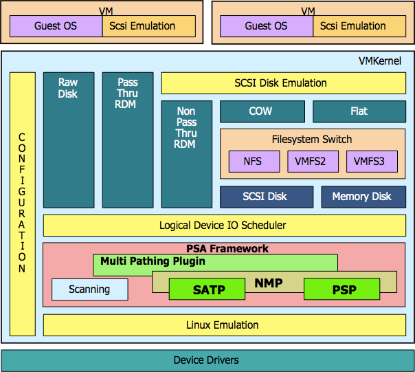

VAAI的实现主要分为两个部分：

- Pluggable Storage Architecture(PAS) Device filter
- VAAI filter

#### PSA (Pluggable Storage Architecture)

https://docs.vmware.com/cn/VMware-vSphere/7.0/com.vmware.vsphere.storage.doc/GUID-C1C4A725-8BE4-4875-919E-693812961366.html?hWord=N4IghgNiBcIAoGUCCIC+Q

vSphere4.0 开始引入的一个可插拔式存储架构，这个架构负责在一些VM内核的任务。允许通过API的方式来嵌入第三方软件来执行到存储的管理和路径选择，即通过扫描处理物理路径的发现和移除。

通过PSA，允许第三方软件开发商根据自己的存储特性设计负载均衡和故障切换的算法，这样可以有效提升ESXi到存储之间的性能。

PAS 主要由两部分组成

- NMP(Native Multipath Plugin)，默认的多路径插件，在没有指定的插件时使用NMP。 NMP的子插件负责管理多路径与负载均衡。
- MPP(Multi Pathing Plugin)，第三方的多路径插件，安装后可以使用，MPP只对自己对应的存储设备负责。

两者下面都有

SATP- Storage Array Type Plugin 阵列类型匹配。监控硬件的健康状态；检查是否存在硬件路径故障 failover；故障检测后执行物理路径切换动作。

PSP-Path Selection Policy 负责在物理链路上执行负载均衡操作，负责负载均衡情况和配置策略，选择一条最优链路进行I/O到Logical Device的传输。当虚拟机发生IO请求时,NMP或者MPP会根据配置的PSP子策略来选择存储设备。


默认情况下，ESXi Host的配置里有三种PSP子策略，分别是MRU（Most Recently Used）、Fixed和RR（Round Robin）

- VMW_PSP_MRU：全称是Most Recently Used，它会优先选择一条系统启动时所能看到的最近使用过的路径来进行I/O传输。
- VMW_PSP_Fixed：固定路径
- VMW_PSP_RR：全称Round Robin，自动选择所有的可用链路来执行I/O传输，进而帮助实现Load Balancing。


#### 

##### 


### VASA

vSphere Storage APIs for Virtual Volumes(VAVS)

存储感知

VMware VASA（vSphere Storage APIs for Storage Awareness）是一组VMware vSphere存储感知的应用程序接口。它允许vSphere虚拟化平台与存储阵列进行通信，以获取关于存储功能和性能的详细信息。

VASA为虚拟化管理员提供了对底层存储基础设施的更深入了解，以优化存储资源的管理和利用。通过VASA，vSphere可以与存储阵列交互，并获取以下信息：

1. 存储容量和利用率：VASA提供了存储阵列的容量信息，包括总容量、已使用容量和可用容量。这使管理员可以更好地管理和规划存储资源。
2. 存储配置和策略：VASA允许存储阵列向vSphere提供存储配置和策略信息。这包括存储性能特性（如快照、复制和压缩）以及存储级别的服务质量（QoS）设置。
3. 存储健康状态：VASA可以提供存储阵列的健康状态信息，包括磁盘故障、RAID状态、电源供应状态等。这有助于管理员及时发现和解决存储问题。
4. 存储性能指标：VASA可以提供存储阵列的性能指标，如IOPS、吞吐量和延迟等。这有助于管理员评估存储性能，并根据需要进行调整和优化。

通过VASA，vSphere可以通过存储阵列提供的接口和信息，更好地了解和管理存储资源。这为虚拟化环境中的存储管理和优化提供了更多的可见性和控制能力。


### EUI vs NAA

https://docs.vmware.com/cn/VMware-vSphere/7.0/com.vmware.vsphere.storage.doc/GUID-A36810F4-00EC-4EA8-A242-2A0DBBF56731.html

> NAA stands for Network Addressing Authority identifier. EUI stands for Extended Unique Identifier. The number is guaranteed to be unique to that LUN. The NAA or EUI identifier is the preferred method of identifying LUNs and the number is generated by the storage device. Since the NAA or EUI is unique to the LUN, if the LUN is presented the same way across all ESXi hosts, the NAA or EUI identifier remains the same. For more information on these standards, see the SPC-3 documentation from the [InterNational Committee for Information Technology Standards](http://www.t10.org/) (T10).


http://kb.vmware.com/selfservice/microsites/search.do?language=en_US&cmd=displayKC&externalId=1014953


## Question: 

- what is SAN
- Nvme 协议的discover
- SCSI 
- Linux 存储
- Cpu DMA 


https://www.codyhosterman.com/2021/03/nvme-of-multipath-configuration-for-pure-storage-datastores/

https://core.vmware.com/resource/configuring-nvmeof-tcp#section1

https://spdk.io/doc/nvmf_multipath_howto.html


提发票request


```sh
./build/bin/nvmf_tgt -m 0x1
./2_tcp.sh
```


应用类型的数据存储实现方式不同，


Kafka 和MySQL client的数据发送方式不同， Kafka Producer可以按照指定的带宽发送，而sysbench无法精确控制数据发送带宽。不同负载的应用场景不同，所以存储的实现方式也不同。

IBM 是否有定制版本，发信给IBM询问


1. 


https://edu.doit.com.cn/videocourse/1504

https://www.sdnlab.com/21087.html

https://zhuanlan.zhihu.com/p/52970477


