大规模容器集群混布, 容器混布产品RUE

为何混布

服务器CPU 成本占比69%。

cpu的平均使用率 10%-20%

提升资源使用率： 

在线业务， 延时敏感，平时低负载，特定时间高峰， 搜索，支付

离线业务： 延时不敏感，计算型，AI训练

集群层面混布方案：

1. 错峰运行，粗粒度 ， 存在资源闲置碎片 
2. 秒级延迟，处理滞后  调整路径长，耗时高
3. 资源预分配，空闲资源无法利用。

如何混布：

调度策略优化+Qos

Caelus  ： 在线/离线  应用画像 资源隔离 干扰检测 冲突处理  （业务特点）

RUE（服务器层面）： CPU  IO NET MEM  

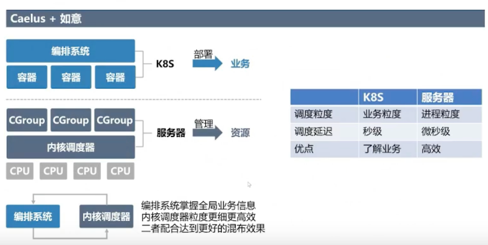

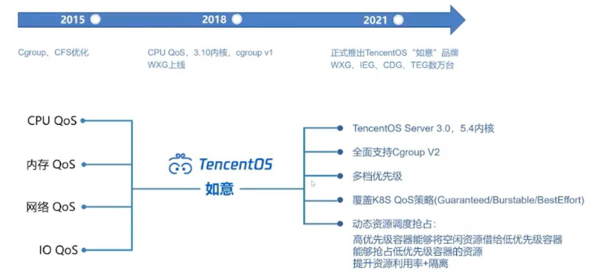

CPU: 绝对抢占，离线负载均衡

IO: BPS,IOPS隔离，Buffer write 抑制

NET: ingress/egress per-cgroup limit , 带宽抢占

Mem: OOM时，优先回收低优先级的内存、Page Cache 隔离

提供精细化的Qos指标，异常记录，统计信息。

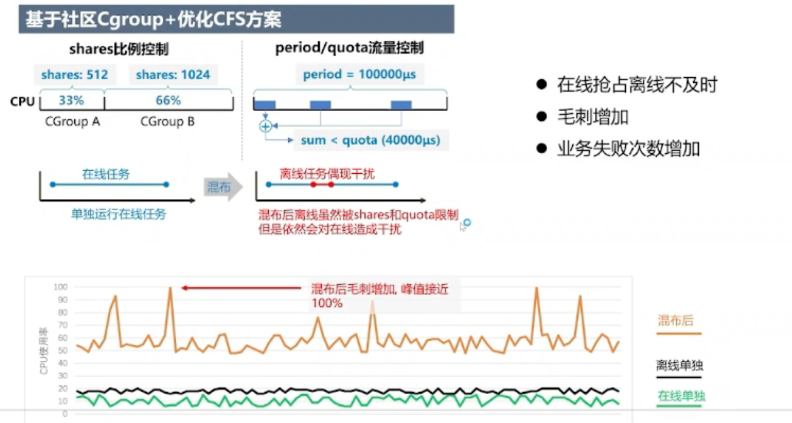

在线抢占离线不及时，会出现CPU毛刺，这种毛刺会导致在线业务失败。

绝对抢占： 不受CFS vruntime的影响

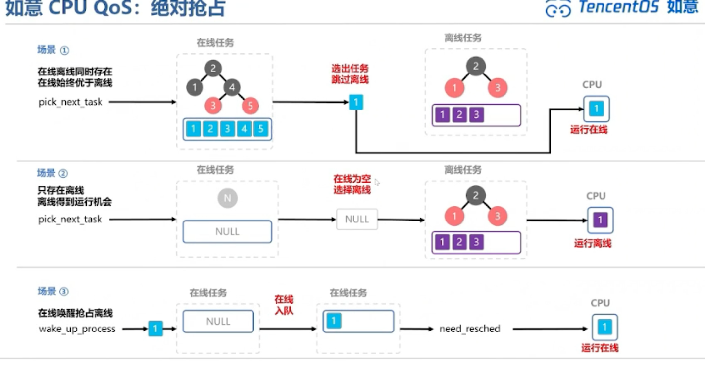

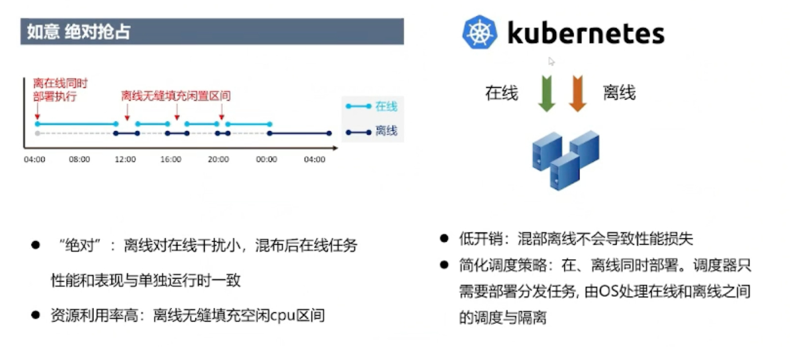

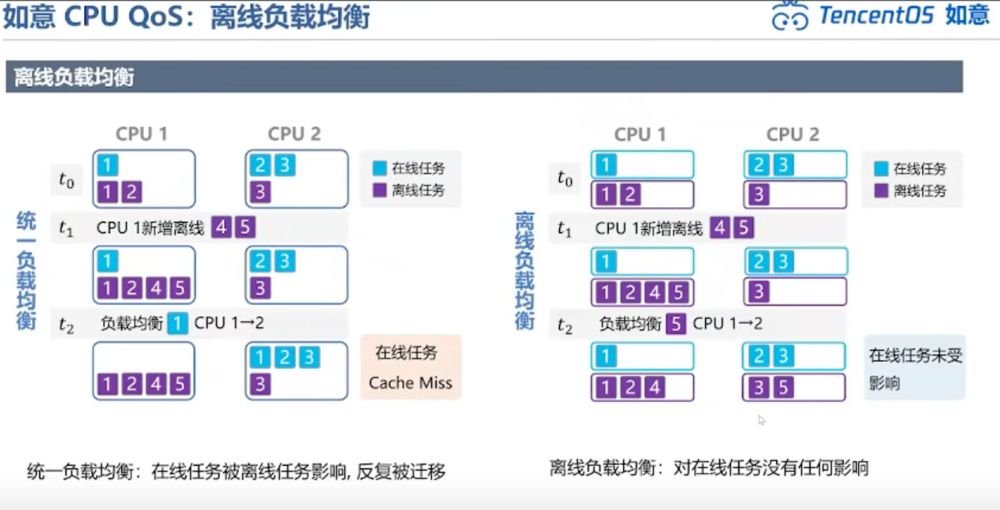

L2  cache 互相干扰

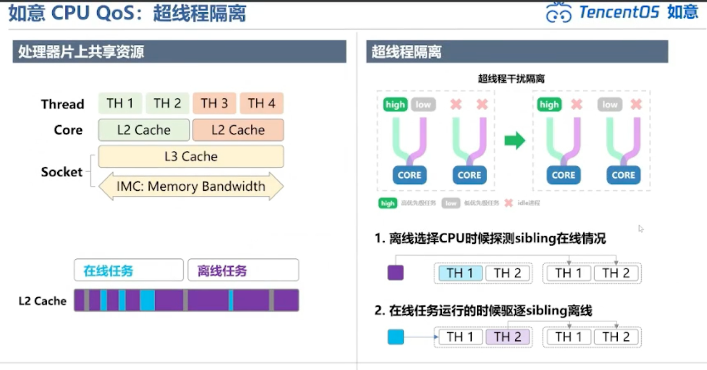

保证在线任务和离线任务不跑在同一个core上

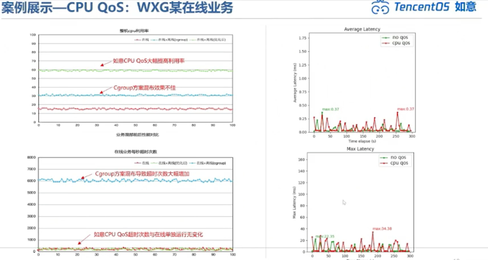

网络QOS: DSCP, 适合发包 传统方案，不是per cgroup级别的配置

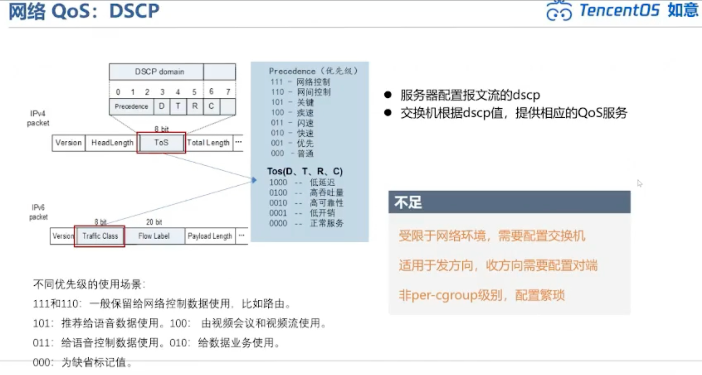

TC: 5% 的性能损耗，比较适合发方向，入方向需要配置fb

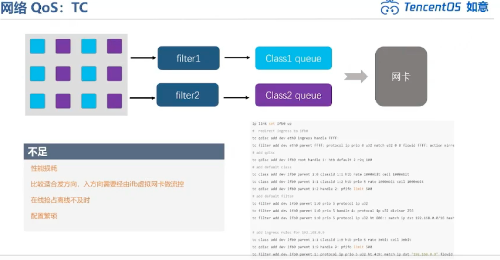

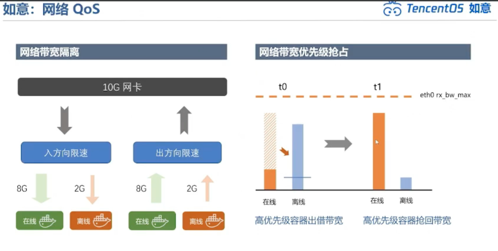

利用率高，抢占快，cgroup v2配置模式

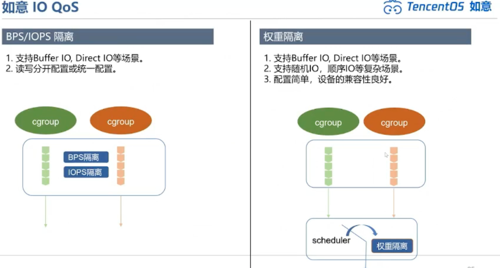

IO抢占

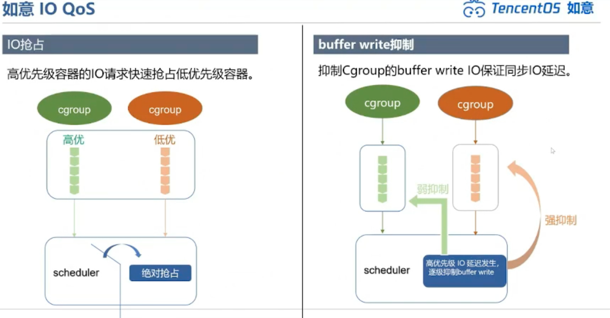

内存OOM时候，kernel会选择低优先级的内存

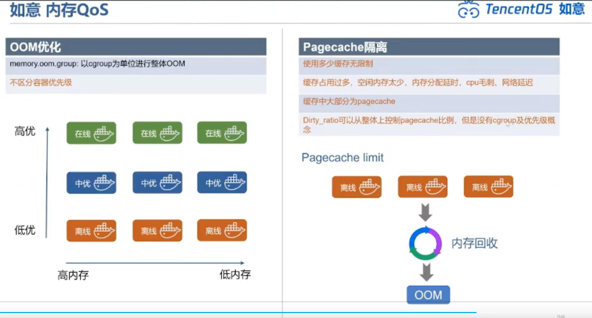

CFS  vruntime ？

网络链路上的拥塞，和服务器上的

OS是怎么识别在线离线业务的？

设置方法:  直接配置cgroup 的优先级配置文件 RUE 0-7。 Caelus。优先级是per-cgroup级别的，层级，父子cgroup

网络使用 cgroup v2， 一个桶的方式？

ebpf 做网络的配置。

SMT 下怎么保证离线不会影响在线业务。

## 混布

以容器为单位混布，降低资源利用率，降低干扰率

NVME TCP 

@congmin  ceps

NVME 协议 TCP PCIE

ceph gateway

理解priority o 的事情理解起来

1. 先把环境搭建起来， vmware + nvme ceph gateway

nvme ceph gateway 跟我们的hard ware关联起来IPU

EPG

Reference

https://www.bilibili.com/video/BV13a411k7pv/?vd_source=0d8e2dd511ce03d514f7f0cb9fa05792

https://www.slidestalk.com/ai_algorithms/OS2ATC_TencentOSQoS78185