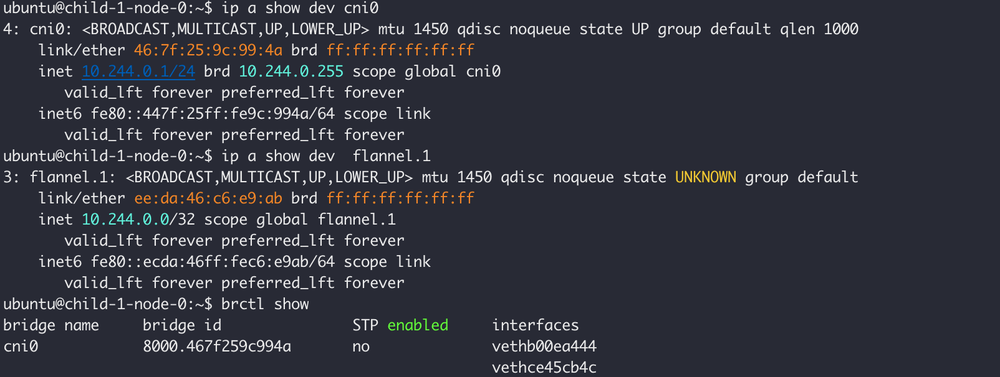

> Flannel  ipam的配置
>
> Flannel 的配置文件路径
>
> 同一台机器上是否允许运行两个cni实例？
>
> pod status 是否可以拿到多个IP


Flannel 是否允许创建多个不同的网络，是否可以与Kubernetes 默认的Pod CIDR不保持一致

Flannle 需要读取k8s init时候设置的pod cidr，这个是怎么读取的，这个pod cidr 和cni 之前有强制绑定关系吗？

Flanneld 做了哪些事情， 如何实现在不同的work node节点实现不同的子网， 如何协商的

kubeadm init cluster的时候指定的Pod CIDR 有什么作用，为什么使用weave和flannel的时候现象不一致。


1. 先部署flannel作为default cni再部署weave的时候，单节点工作正常，跨节点网络不通？ 

2. 先部署weave，作为default cni， 再部署flanne时候，需要指定flannel的默认pod CIDR。

vxlan是原理， Overlay网络

multus 是如何组织多个cni之间的关系的。

submariner 支持的 CNI， 如何在这些cni中选择一个做个dedicate的CNI

Weave

## Flannel

Flannel是一个专门为Kubernetes集群设计的一个简单易用的配置3层网络的组件。

Flannel 在每一个节点上都会运行一个flanneld的进程，这个进程主要用来为每一个节点分配一个从Cluster设置的范围内拿到的一个子网。 例如在初始化Cluster范围内的子网为 10.244.0.0/16, 其中的一个work node节点拿到的子网范围是10.244.0.1/24， 这个配置会存储在 /run/flannel/subnet.env 这个文件中。当需要再这个work node上部署pod时，调用CNI，flannel就会根据这个路径对应的配置，生成一个有效的veth pair配置到pod中。


Flannel 直接使用Kubernetes API或者etcd存储网络配置，子网分配和其他辅助信息(例如 host的Public IP)。数据包使用一种backend mechanism进行转发，包括 VXLAN，host-gw, WireGurad,以及UDP。

Kubernetes假设在集群中每一个container/Pod 有一个唯一的，可路由的IP。 这种模式的优点在于，消除了共享单个主机IP带来的端口映射的复杂性。

Flannel负责在集群的多个节点中提供三层IPv4网络的联通性。Flannel不控制容器与Host之间的网络通信，只负责Host与Host之间的网络通信。Flannel为K8s提供了CNI插件，也为docker提供的集成方案。


## Flannel的运行方式

尽管不是必须的，推荐使用Kubernetes API 作为flanneld的存储，避免再为flannel 部署一个etcd。这种模式称为 `kube subnet manager`。

```sh
/opt/bin/flanneld --kube-subnet-mgr --ip-masq
```


Flannel 使用portmap 作为默认的CNI网络插件。使用Flannel前确认CNI Network Plugins 已经安装到了/opt/cni/bin.

Flannel有两种运行方式，一种是使用Kubernetes API作为Flannel的存储，另一种是依赖etcd作为存储。

- co-work with K8s: `--kube-subnet-mgr=true` 时候，flannel从`/etc/kube-flannel/net-conf.json`中读取配置文件。

- Standalone: `--kube-subnet-mgr=false` 时候，flannel 从etcd中读取配置文件。默认会从`/coreos.com/network/config`中读取配置文件(etcd 的前缀可以通过 `--etcd-prefix`指定)。当使用这种方式运行时，需要使用etcdctl 在etcd中设置 flannel的配置参数。

  

### 默认运行方式


### Standalone 运行方式

修改VXLAN Identifier

修改Bridge

可以指定iface

## Flannel的架构

flannel.1 和 cni0 的作用  `ip -details a show dev cni0`




Cni0,  Bridge 设备，每创建一个Pod都会创建一对Veth Pair。 其中一端置于pod中,作为网卡，另一端连接到网桥上，作为网桥的端口。Pod中发出的流量都会通过veth pair到达cni0 网桥上。 cni0设备获得的IP地址是该节点分配到的网段的第一个地址。


Flannel.1 overlay 网络设备， 用来进行vxlan的报文处理(解包和封包)。不同node之间的Pod数据流量都从 overlay设备以隧道的形式发送到对端。


Flanneld, flannel在每一个node上运行flanneld作为agent，他会为当前node从集群的网络地址空间中获取一个子网段。当前node上所有Pod的IP都从这个子网中分配。 同时，Flanneld监听k8s的集群数据库，为flannel.1 设备提供封装数据所必要的mac，ip 等网络数据信息。


## 通信流程过程

flannel.1 为vxlan设备，当数据到达flannle.1时，需要将数据包封装起来，此时dst ip 为，src ip 为，数据封包需要知道dst ip 对应的mac地址。此时flannel.1 不会发送arp请求去获得dst ip 的mac地址，而是由linux kernel 将一个“L3 Miss” 时间请求发送到用户空间的flanneld程序。Flannled收到内核的请求事件后，从etcd查找能够匹配该地址的子网flannne.1 设备的mac地址，即发往pod所在的hsot种的flannel.1 设备的mac地址。 Flannel在为node节点分配ip网段时记录了所有的网段和mac等信息。


## 不同的后端封装


weave 多实例运行


