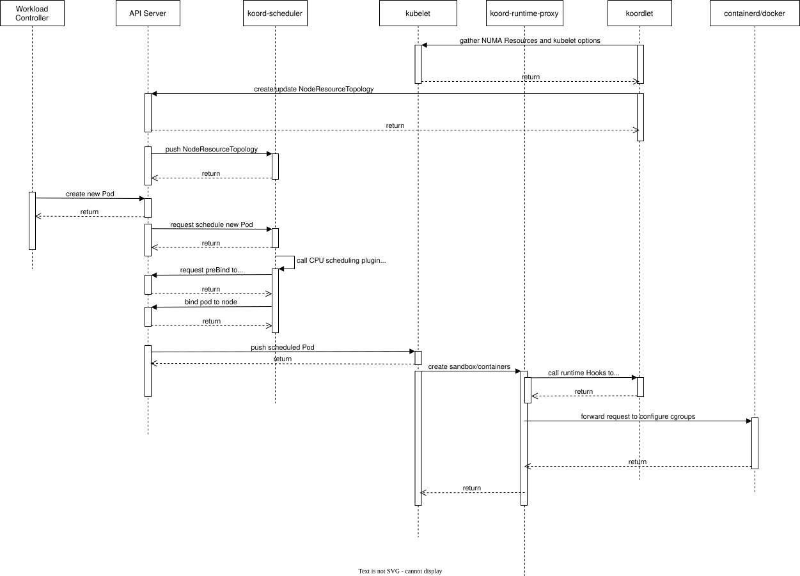
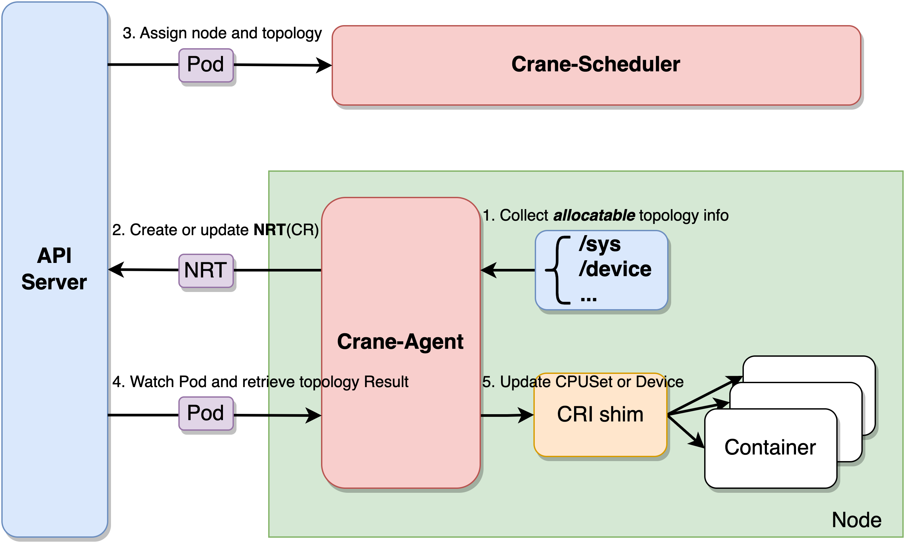
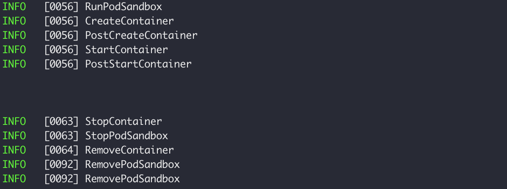

History and Background

Various extension mechanisms over the years

OCI hooks

- custom actions executed at various container lifecycle events
- runc , cri-o ?

Runtime wrapper using runtime classes

- Custom actions implemented by custom runtime wrapper
- a bit of kludge
- runc/crun/etc.. containers/cri-o

NRI

- custom actions at pod or container creation/stop
- Containerd

NRI evolution

- Subject of this presentation?

  

What is NRI

NRI: Node resource interface, a common framework for

- Plugging extensionsinto OCI-compatible runtimes

- Implementing custom container configuration logic

common

- plugins work identically i supported runtimes
- Support present in commonly used runtimes

framework

- multiple NRI pieces
- collectively achieve NRI's goal

pluggable extensions

- Alter behavior without runtime modifications

Custom logic

- Your cluster, you plugin, your rules
- within the allowed boundaries imposed by NRI

plumbing to enforce how containers are configured

- Initially, during container creation
- Subsequently, by container updates
- Potentially, in response to some external events 

=> you cluster, you plugin, your rules

- within the allowed boundaries imposed by NRI


How Does it work?


What can it do?


Write An NRI Plugin


#### Reference

https://kccncna2022.sched.com/event/182JT

https://kccnceu2021.sched.com/event/iE1Y/maximizing-workloads-performance-with-smarter-runtimes-krisztian-litkey-alexander-kanevskiy-intel


# NRI(Node Resource Interface): 节点资源控制接口


## 背景

为什么需要NRI

为了实现更细粒度的资源管理，例如CPU编排，内存分层，目前很多K8s周边的开源项目通过一些out of tree的方式实现了对Kubenets资源分配的细粒度管理。例如：Koordinator, Crane, CRI-RM。

### Koordinator

[Koordinator](https://koordinator.sh/docs/)是基于 QoS 的 Kubernetes 混合工作负载调度系统。 Koordinator在kubelet和CRI runtime 之间增加了一个`koord-runtime-proxy`组件来接管kubelet CPU管理策略，从而实现实现的精细化CPU编排。所以对kubelet来说， 它调用的CRI Runtime是koord-runtime-proxy， 然后再由 koord-runtime-proxy 去调用真正的CRI Runtime。

当 koordlet 启动时，koordlet 从 kubelet 收集 NUMA 拓扑信息，包括 NUMA 拓扑、CPU 拓扑、kubelet CPU 管理策略、kubelet 为 Guaranteed Pod 分配的 CPU 等，并更新到节点资源拓扑 CRD。当延迟敏感的应用程序扩容时，可以为新Pod设置 Koordinator QoS LSE/LSR、CPU绑定策略和 CPU独占策略，要求 koord-scheduler 分配最适合的 CPU 以获得最佳性能。当 koord-scheduler 调度 Pod 时，koord-scheduler 会过滤满足 NUMA 拓扑对齐策略的节点，并通过评分选择最佳节点，在 Reserve 阶段分配 CPU，并在 PreBinding 时将结果记录到 Pod Annotation。koordlet 通过 Hook kubelet CRI 请求，替换通过 koord-scheduler 调度的 CPU 配置参数到运行时，例如配置 cgroup。


对K8s的侵入性。




### Crane

[Crane](https://gocrane.io/) 是一个基于 FinOps 的云资源分析与成本优化平台。Crane提供的资源拓扑感知调度给予了精细调度的能力，将调度的粒度扩展到设备级别。Crane-Scheduler和Crane-Agent配合工作，完成拓扑感知调度与资源分配的工作。Crane-Agent从节点采集资源拓扑，包括NUMA、Socket、设备等信息，汇总到NodeResourceTopology这个自定义资源对象中。Crane-Scheduler在调度时会参考节点的NodeResourceTopology对象获取到节点详细的资源拓扑结构，在调度到节点的同时还会为Pod分配拓扑资源，并将结果写到Pod的annotations中。Crane-Agent在节点上Watch到Pod被调度后，从Pod的annotations中获取到拓扑分配结果，并按照用户给定的CPU绑定策略进行CPUSet的细粒度分配。




### CRI-RM

CRI 资源管理器是一个CRI Runtime的接口代理。 它位于客户端(Kubelet)和实际的CRI Runtime实现(containerd、cri-o)之间中继请求和响应。 代理的主要目的是将硬件感知的资源分配策略应用于系统中运行的容器。


通过以上几个项目的实现，我们可以简化一下这些项目的架构。Koord


## NRI 简介


NRI, Node Resource Interface, 用于控制节点资源（如cgroups）的公共接口,是OCI兼容的容器运行时(Container Runtime)插件扩展的通用框架。它为插件提供了跟踪容器状态，并对其配置进行有限修改的基本机制。

NRI本身对任何容器运行时(oci-runtime)的内部实现细节是不感知的。它为容器运行时提供了一个适配库，用于集成到NRI和插件进行交互。原则上，任何NRI插件(NRI Plugin)都应该能够和启用NRI的运行时(NRI-enabled Runtimes)正常协作。


NRI是是Containerd的一个子项目， 


### NRI工作原理

目前的K8s架构中，kubelet通过调用CNI兼容的容器运行时创建和销毁Pod。CRI Runtime 再通过调用OCI spec 兼容的low-level runtime创建contaienr。


### Runtime Adaptaion： 运行时适配器

NRI 运行时适配器是OCI 运行时集成到NRI和与NRI交互的接口。它实现了基础插件发现，启动和配置。它还提供了从运行时将NRI插件连接到Pod和容器的生命周期事件中的功能。

多个NRI插件可能在处理同一个Pod或者Container的生命周期事件。

### Wrapped OCI spec Generator：OCI 规范生成器

OCI规范生成器主要用于NRI 插件用来调整和更新OCI Spec, 然后NRI插件生成调整后的响应信息。

### Plugin Stub Library：插件依赖库

Plugin stub library隐藏了NRI插件的底层实现细节，它负责连接建立、插件注册、配置和事件订阅。目前，NRI提供的所有示例插件都通过Plugin stub library实现。这些示例插件的实现都可以用作学习使用Plugin stub library的教程。


### Containerd 集成NRI


Contained对NRI的支持分成两部分，逻辑部分和物理部分。这些部分是一个通用插件(/nri/*)，可以来集成到NRI，和CRI-specifice bits(/pkg/cri/server/nri-api), 用来转换数据， 运行时不可知的NRI表示 和 CRI 插件的内部表示。


containerd NRI Plugin

containerd 通用NRI Plugin 实现了与NRI集成和交互的核心逻辑。但是在其中并不了解 Pod或者container的表示。它定义了一个附加的接口，领域，每当将内部的表示形式，转换为runtime不感知的  NRI的表示形式时，

Domain 可以被视为一个short-cut name for Doamin-Namespace, Domain 实现了通用NRI接口的函数， 需要通特定的containerd 的namespace处理pod和container.  containerd 的命名空间隔离了client和containd的状态。

E.g. "k8s.io" for K8s CRI clients, ,"moby" for docker clients, and "containerd " as the default for containd/ctr.


NRI support for CRI Containers

The containerd CRI plugin register itself, as an above mentioned NRI Doamin for the "k8s.io" namespace. to allow container configuration to be customizec by external NRI plugins.

目前Domain接口只针对原始的CRI进行了实现。

NRI Support for Other Container "Domains"


containerd 主要工作在平台(docker or k8s)和更底层的 runtime (runc , kata)之间。containerd提供容器进程的管理， 镜像的管理，文件系统快照以及元数据和依赖管理。


NRI plugin: 节点资源接口插件，管理cgroups 和拓扑

NRI可以用来解决批量计算，延迟敏感性服务的性能问题， 以满足服务SLA/SLO,优先级等用户需求。 例如性能需求， 通过将容器的CPU分配统一NUMA node，来保证numa内的内存调用。除了NUMA，还有CPU，L3 cache 等资源拓扑亲和性。

当前kubelet的实现的是通过cpumanager 的处理对象只能是guaranteed 类的pod， topologyManger 通过cpuManager提供的hints实现资源分配。

kubelet 当前也不适合处理多种需求的扩展，因为在kubelet增加细粒度的资源分配会导致kubelet 和CRI的界限越来越模糊。

而NRI，则是在CRI同期生命周期间做调用，适合做 resource pinning 和节点的拓扑感知。并且在CRI内部做插件定义和迭代，可以做到上层 kubenetes 以最小的代价来适配变化。 


在容器的生命周期中，CNI/NRI插件能够注入容器初始化进程的Create和start之间：

Create-> NRI-> Start

以官方例子 clearfs： 在启动容器前， 依据Qos类型调用cgroup命令，cpu.cfs_quota_us为-1 表示不设上限。

NRI直接控制cgroup，所以有更底层的资源分配方式。 不过越接近底层，处理逻辑越复杂。


Why NRI:

支持定制化扩展，kubelet 可以直接载入扩展配置，无需修改自身代码

通过与CRI交互，kubelet 可以将部分复杂的CPU分配需求下方到 runtime 来处理。


应用程序如何独占一个CPU？

NUMA 简介？


。


##  NRI deploy


Download the latest release version with NRI Path

```sh
git clone -b v1.7.0-beta.3 https://github.com/containerd/containerd.git
sudo apt install libbtrfs-dev # ubuntu22/20
cd containerd 
make
```


Replace the old containerd

```sh
sudo mv bin/containerd /usr/local/bin/containerd 
```


```sh
  [plugins."io.containerd.nri.v1.nri"]
    config_file = "/etc/nri/nri.conf"
    disable = false
    plugin_path = "/opt/nri/plugins"
    socket_path = "/var/run/nri.sock"
```


/etc/nri/nri.conf

```sh
disableConnections: false
```


## NRI Plugin	


### NRI 请求日志插件	

这个插件记录的NRI的请求和事件。你可以配置插件的订阅内容。 通过这个插件可以往容日中配置环境变量或者annotation 用来测试。

```sh
./build/bin/logger -idx 00
```


此时新建一个container，可以看到 loggr-plugin 会捕获以下events： `RunPodSandBox,CreateContainer,PostCreateContainer,StartContainer, PostStartContainer`

如果我们我们删掉这个container，也可以捕获到对应的event:

`StopContainer,StopPodSandbox,RemoveContainer, RemovePodSandbox`。




我们可以捕获到container 创建的事件，此时，我们就可以修改 podspec的信息。 例如增加/修改环境变量，或者增加/修改annotation.

修改之后变动通过`k descirbe pod nginx` 是看不到修改信息的。 NRI的修改只作用于OCI层，对CRI层来说是无感知的。


### NRI Differ Plugin

Differ 插件可以注入到其他NRI插件之前/之后/或者其他插件之间，track 和显示其他NRI插件修改了容器请求的那些内容。这个插件支持多次注册到多个索引位置。 所以一个Differ Plugin实例可以用来跟踪和显示所有对Container做的修改。


在测试Differ Plugin时可以为其指定Index，例如 `nri-differ --indices 00,20,99 --yaml` 。

然后就可以看到 修改后的yaml diff。


### Device Injector Plugin


这个插件可以使用Pod 的annotation往Container中注入device或者挂载存储路径。

#### Device annotations					

annotation key 的格式是`devices.nri.io/container.$CONTAINER_NAME`, 这样就可以把设备注入到名为`$CONTAINER_NAME`的容器中。如果使用`devices.nri.io` 或者`devcies.nri.io/pod`作为key，就会把设备注入到所有的容器中。

设备注入的语法如下：

```yaml
- path: /dev/dev0
  type: {c|b}
  major: 1
  mainor: 3
  file_mode: <permission mode>
  uid: <user ID>
  gid: <group ID>
  
# file_mode, uid and gid can be omitted, the rest are mangatory
```


#### Mount Annotation

mount 的annotation格式和Device基本一致，annotation的前缀是`mounts.nri.io`

```sh
- mount: <mount source0>
  destination: <mount destionation0>
  type: <mount type>
  options:
    - option0
    - option1
```

```sh
device-injector -id 10
```


#### OCI Hook Inject Plugin

支持OCI的runtime的配置具有hook 功能，可以自定义功能，关联到Container的生命周期中。这个插件使用Podman的HookManger实现了在容器中注入OCI hook. 使用这个包同时也可以实现CRI-O的原生hook注入。这个插件基本上实现了CRI-O兼容的OCI hook注入。

```sh
hook-injector -idx 10
```


## NRI 


1. NRI 测试环境搭建
2. OpencloudOS 安装，docker install and test， create a pr
3. 咨询qiaowei


CRI-RM 


https://www.modb.pro/db/462537


https://zhuanlan.zhihu.com/p/490585683


生产环境部署，测试环境，region


1. 注入部署环境相关的环境变量。

   背景：

   在实际的生产环境中，需要应用程序会根据不同地区，不同环境采用不同的配置来运行程序。

   例如web服务A，当部署在us地区时候，需要根据环境变量REGION=us，读取对应的数据库配置文件。

   或者ENV=test，需要读取测试数据库的配置文件。


​			当用户部署应用程序的时候，云平台需要根据对应的部署环境再Deployment.yaml中增加对应的环境变量。在多集群部署时，如果想往us地区和cn地区部署相同的实例，需要生成两个不同的Deployment.yaml 文件，用户需要显式的在yaml中指定REGION=us 或者REGION=cn。


通过NRI可以将这部分环境变量的修改下沉到OCI层。用户在部署的时候无需在Deployment.yaml 中显式指定部署地区的环境变量。可以由对应地区的NRI Plugin注入对应地区的环境变量。

1. 

   应用


ttrpc / grpc


## NRI ResourceManger

https://github.com/jukkar/nri-resmgr/tree/preview


Numa 检查工具

```sh
numactl --hardware

# apt install 
 sudo apt install  hwloc-nox
 lstopo
```


