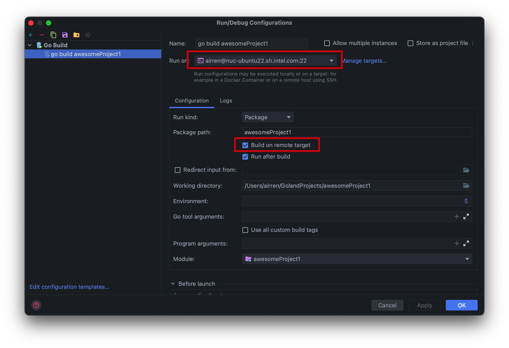
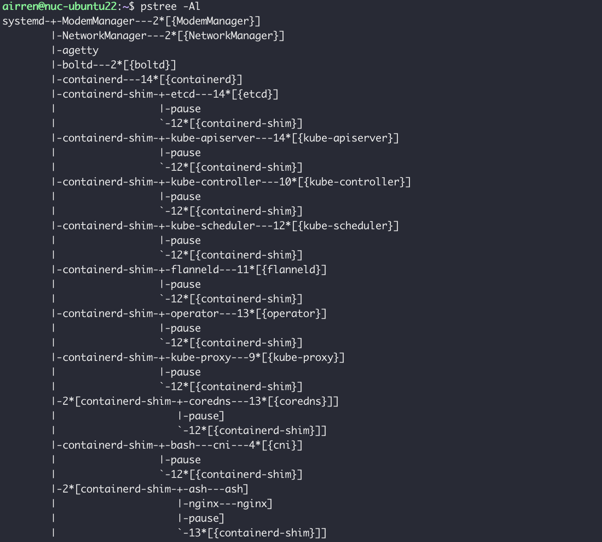

golang远程调试

run on / 配置deployment ，设置同步路径



### Containerd的进程模型

- Containerd进程为守护进程，其他进程可以通过grpc进行访问
- containerd-shim进程: 启动一个sandbox，需要先为其创建一个Containerd-shim进程。pod内的其他进程都是containerd-shim进程的子进程. 创建一个namespace，创建一个pause进程，指定改进程为前面描述的namespace。
  - 业务进程为pause进程对应的namespace
  - 





### Namespace

查看一个进程的namespace, `/proc/<pid>/ns`

宿主机进程的namspace和containd shim的namespace相同。

pause进程的namespace不是宿主机的。

pod中pause 和业务进程除了 `mnt namespace`不同，其他都是相同的。

### cgroup 配置

```sh
systemd-cgls
```


代码调试

### 调试cri相关服务

containerd是k8s的运行时，我们关注kubelet和containerd的交互啊，而crictl很好的模拟了这种交互，我们通过crictl执行相关命令就可以实现这些服务的调试。

具体cri实现参考pkg/cri/server 里面每个go文件都是一个cri接口的实现。我们再/pkg/cri/server/image_list文件打断点，然后我们在远程主机上执行

crictl image list

看到goland中的断点进入了：

###  调试containerd-shim启动

3.3.1 containerd-shim启动时机

创建sandbox时，会启动shim进程

3.3.2container-shim如何启动

启动命令帮助命令如下

markdown[root@172-0-0-4 containerd]# /usr/local/bin/containerd-shim-runc-v2 --help
Usage of /usr/local/bin/containerd-shim-runc-v2:
-address string
grpc address back to main containerd
-bundle string
path to the bundle if not workdir
-debug
enable debug output in logs
-id string
id of the task
-namespace string
namespace that owns the shim
-publish-binary string
path to publish binary (used for publishing events) (default "containerd")
-socket string
socket path to serve
-v show the shim version and exit

实例用法

```text
/usr/local/bin/containerd-shim-runc-v2 -namespace k8s.io -id 4dc4f2c0b8fe5f9c2921df05d648464bba4ff -address /var/run/containerd/containerd.sock
```

3.3.3 模拟containerd-shim启动

这个流程很繁琐，后续再说。


#### 深入理解cgroup https://zhuanlan.zhihu.com/p/75422252


containerd 源码阅读

https://www.jianshu.com/p/d8f6c40280f8

https://weizhang555.github.io/post/containerd-code-analysis/
