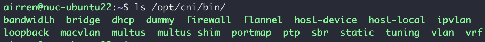
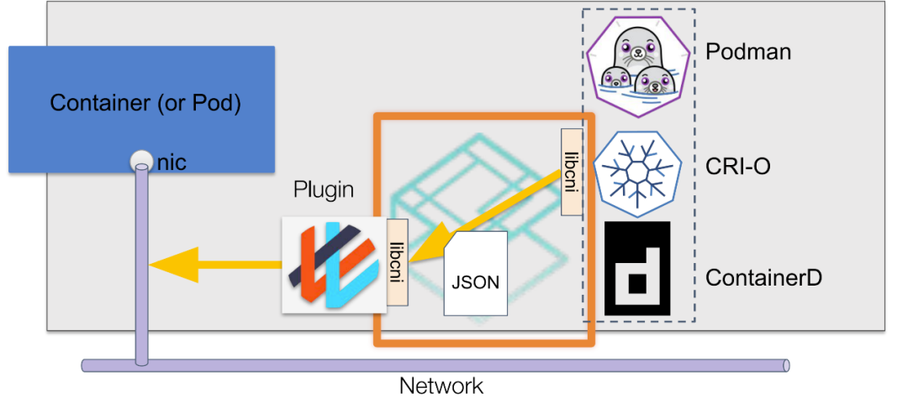
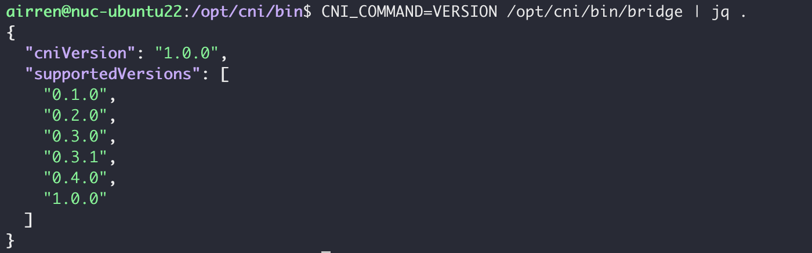
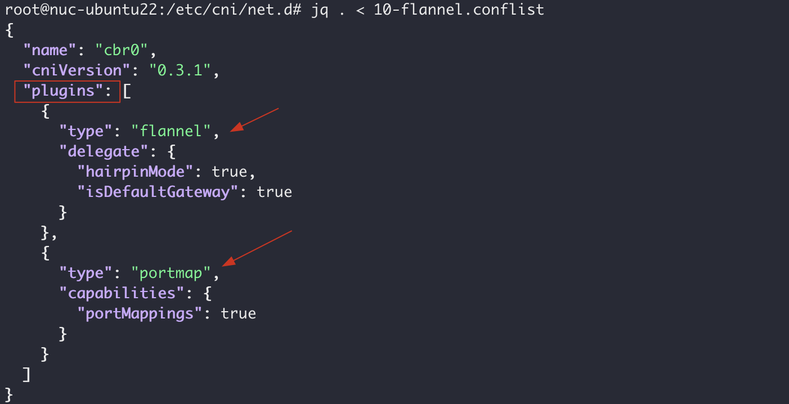
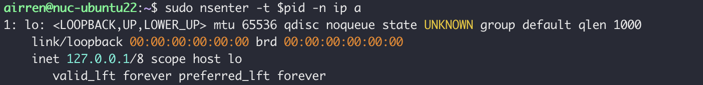
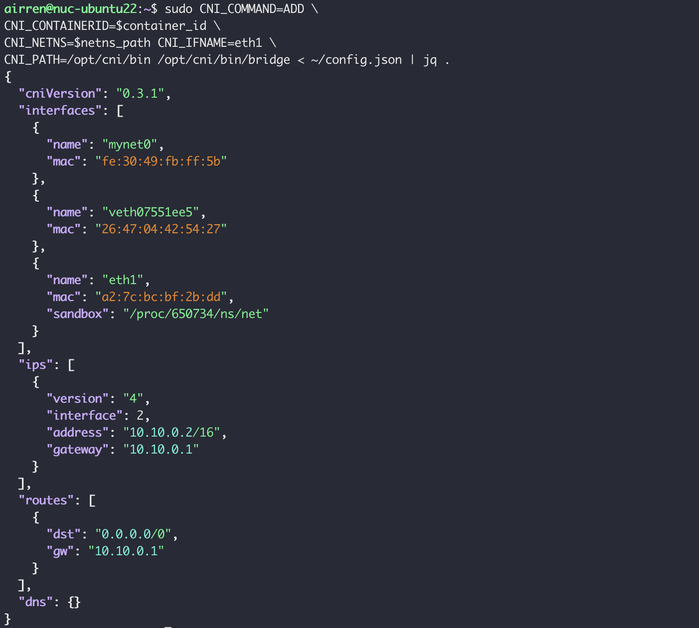
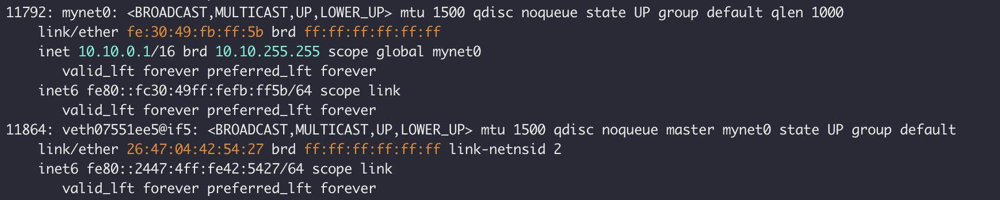
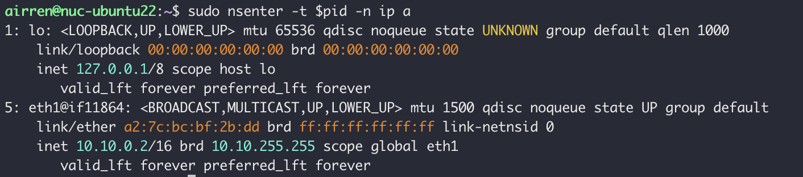
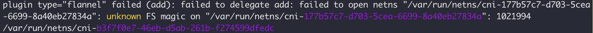
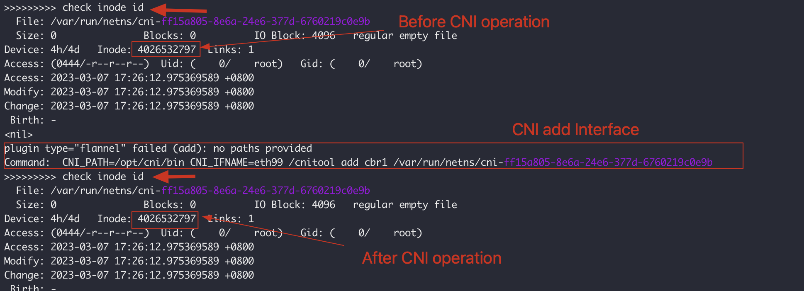

> CNI 定义了runtime网络管理的规范，同时提供了一些内置的标准实现，并提供了一个go libcni封装了对CNI的调用。


Kuberntes 在创建pod的时候，需要为每一个pod提供网络连接，实现网络连接的方式有很多种，所以我们可以指定一个规范，让所有的网络连接实现都遵循这个规范，这样就可以为pod的网络连接实现多种不同的解决方案， 这个规范就是CNI。

CNI 定义了一套接口标准，提供了规范文档以及一些标准实现。采用CNI规范来设置容器的网络不需要关注网络具体的实现细节，只要按照CNI规范来调用CNI接口即可实现网络的设置。


## CNI的背景

CNI最初是由CoreOS为rkt容器引擎创建的，随着不断发展，已经成为事实标准。目前绝大部分的容器平台都采用CNI标准（rkt，Kubernetes，OpenShift等）。

Docker并没有采用CNI标准，而是在CNI创建之初同步开发了CNM（Container Networking Model）标准。但CNM模型并没有得到广泛的应用。


> 完成容器生命周期时，运行时必须以相反的顺序执行插件，以将容器与网络断开


## CNI是什么


CNI定义了一个接口规范，这个接口并不是指HTTP，或者gRPC接口，而是对可执行程序的调用(exec)。这些可执行程序就是CNI插件。CNI接口规范定义了这个可执行程序的输入、输出的标准和具体的操作。

kubelet 通过这个标准的API来调用不同的网络插件，以实现不同的网络配置方式，实现了这个接口的就是CNI插件。它实现了一系列CNI API接口。常见的CNI插件包括 Calico、flannel、Weave Net 以及Clilium.


在kubernetes中，CNI插件的默认存储路径为`/opt/cni/bin`。 在k8s部署节点上的这个路径下面可以看到有多个CNI插件。




> 默认的CNI插件的介绍？

- 每一个CNI的实现都有一个对应的配置文件，存储在`/etc/cni/net.d/***.configlist`
- 每一个CNI的实现都是一个Binary，存储在`/opt/cni/bin/***`


CNI安装的时候，是怎么更新 configlsit 和 把Binary copy到`/opt/cni/**`的 


CNI 标准规范接口，包含了添加，检查，验证，删除网络等接口，并提供了按照列表或单个进行网络配置的两组接口。CNI 从容器管理系统(dockershim) 处获取运行时信息(Container Runtime)，包括 network namespace 的路径，容器 ID 以及 network interface name，再从容器网络的配置文件中加载网络配置信息，再将这些信息传递给对应的插件，由插件进行具体的网络配置工作，并将配置的结果再返回到容器管理系统中。


作者：热爱coding的稻草
链接：https://www.jianshu.com/p/8b7be8059171


CNI支持与第三方的IPAM的集成。


CNI 插件根据功能可以分为三类

Main 插件： 用来创建具体网络设备。

Meta插件: 由CNI社区维护的内置插件，不能作为独立的插件使用，需要调用其他的插件。 

- tuning：
- portmap
- bandwith

IPAM插件： IP Address Management, 负责分配IP地址，避免IP冲突

- dhcp:  会向dhcp服务器发起请求，获取IP
- host-local: 使用预先配置的IP地址段来进行分配


## CNI是如何工作的


kubelet 启动的时候可以指定cni的配置路径， kubelete --network-plug=cni ,--cni-conf-dir 指定networkconfig 配置路径，默认为`/etc/cni/net.d` --cni-bin-dir 指定plugin的可执行文件路径，默认为`/opt/cni/bin`

在集群中创建一个pod的时候，首先会回通过Apiserver将pod的配置写入etcd. Scheduler 在侦听到create pod这个事件后，会将这个pod调度到某个具体的节点上。 Kubelet 监听到这个pod创建之后，会调用cri plugin 创建pod. Cri shim 回根据kubelet 传递过来的network config，读取配置目录中的配置文件，配置文件中会指定使用哪一个CNI插件，然后去执行具体的CNI插件的二进制文件，再由CNI插件在pod对应的网络空间中去插入veth pair。 配置完成后，kubelet 就完成了整个pod的创建过程，这个pod也就在线了。





CNI通过JSON格式的配置文件来描述网络，当需要设置网络内容时，由运行时执行CNI插件，并通过CNI的标准输入(stdin) 来传递配置文件的信息， 通过标准输出(stdout)接收插件的执行结果。 上图中的libcni是CNI提供的一个Go Package, 封装了符合CNI规范的标准操作，便于容器运行时和网络插件对接CNI标准。


### 启动流程源码分析

kubelet 在Node节点上负责Pod的创建、销毁、监控上报等核心流程，通过cobra命令解析参数。

```sh
// kubernetes/cmd/kubelet/kubelet.go

```


```sh
cmd-> Run -> PreInitRuntimeService -> RunKubelet -> createAndInitKubelete -> startKubelet -> Run
```

其中 PreInitRuntimeService 会进一步初始化 dockershim，一方面探测环境中的网络配置文件(默认路径为：/etc/cni/net.d/*.conf/.conflist/.json)，进行 CNI 网络配置；另一方面启动 gRPC docker server 监听 client 请求，进行具体的操作如 PodSandbox、Container 创建与删除。

当监听到 Pod 事件时，进行对应 Pod 的创建或删除，流程如下：

> Run -> syncLoop -> SyncPodCreate/Kill -> UpdatePod -> syncPod/syncTerminatingPod -> dockershim gRPC -> Pod running/teminated

### CNI的环境变量	


### CNI的配置文件

### CNI的基本操作

### CNI链式调用

### CNI IP分配								


## Pod 创建/删除

K8s 中 Pod 的调谐采用 channel 生产者-消费者模型实现，具体通过 PLEG(Pod Lifecycle Event Generator) 进行 Pod 生命周期事件管理。


```go
// kubernetes/pkg/kubelet/pleg/pleg.go
// 通过 PLEG 进行 Pod 生命周期事件管理
type PodLifecycleEventGenerator interface {
    Start() // 通过 relist 获取所有 Pods 并计算事件类型
    Watch() chan *PodLifecycleEvent // 监听 eventChannel，传递给下游消费者
    Healthy() (bool, error)
}
```

Pod 事件生产者 - 相关代码：

```go
// kubernetes/pkg/kubelet/pleg/generic.go
```

```go
/ kubernetes/pkg/kubelet/kubelet.go
```


```go
kubernetes/pkg/kubelet/
```


> CNI 需要指定那些环境变量，CNI Usage

举个🌰，手动调用CNI 创建NETwork 的命令模板如下：

```sh

CNI_COMMAND=ADD CNI_XXX=XXX   ./bridge < config.json
```

参数的传递主要是 通过设置环境变量， 以及从标准输入传入的配置文件。

CNI插件用到的环境变量主要有以下几个：

```sh
CNI_COMMAND  # 定义期望的操作 ADD/DEL/CHECK/VERSION
CNI_CONTAINER #	 容器的ID，由容器运行时管理容器的唯一标识符
CNI_NETNS #容器network namespace 的路径 Absolutely Path， 例如 /run/netns/cni-4011fc7f-xxx
CNI_IFNAME # 需要被创建的网络接口的名称，例如 eth1
CNI_ARGS # 运行时调用时额外传入的参数，格式为分号间隔的k-v， 例如 FOO=BAR;FUNC=123
CNI_PATH # CNI可执行文件的路径， 例如/opt/cni/bin
```

JSON配置文件

> 0.3.1 配置文件？


配置文件示例

```json

{
  "cniVersioin": "0.4.0",  // 表示希望遵循的CNI标准的版本
  "name": "mynet",         // 表示基于这个配置文件创建的网络名称
  "type": "bridge",        // 插件类型，对应 /opt/cni/bin 下的Binary
  "bridge": "cni0",        // Bridge 插件的参数，用于指定bridge name，其他插件没有
  "ipam": {                // IP Allocation Management，管理IP地址分配
    "type": "host-local",   // IPAM插件的类型
    "subnet": "10.1.0.0/16",   // IPAM定义的参数
    "gateway": "10.1.0.1"
  }
}
```


配置文件分为公共定义部分和插件定义部分，公共部分允许CNI插件定义属于自己的数据结构。

```go
// https://github.com/containernetworking/cni.git
// libcni/api.go:68
type NetworkConfig struct {
	Network *types.NetConf    // 公共定义部分
	Bytes   []byte            // 插件定义部分
}

// pkg/types/types.go:60
// NetConf describes a network.
type NetConf struct {
	CNIVersion string `json:"cniVersion,omitempty"`  // 希望遵循的CNI版本

	Name         string          `json:"name,omitempty"`  // 网络名称，用于CNI管理，当前主机唯一
	Type         string          `json:"type,omitempty"`  // CNI 类型，对应Binary的文件名
	Capabilities map[string]bool `json:"capabilities,omitempty"`
	IPAM         IPAM            `json:"ipam,omitempty"`  // 表示IP地址分配插件配置
	DNS          DNS             `json:"dns"`

	RawPrevResult map[string]interface{} `json:"prevResult,omitempty"`
	PrevResult    Result                 `json:"-"`
}

```


配置文件最终实在CNI插件中被解析的，所以我们可以在CNI的实现中看到配置文件对应的完整的struct。以Bridge为例，

```go
// https://github.com/containernetworking/plugins.git
// plugins/main/bridge/bridge.go:47
type NetConf struct {
	types.NetConf                    // 配置文件公共部分
	BrName       string `json:"bridge"`     // Bridge Name,以下为Bridge插件定义的私有部分
	IsGW         bool   `json:"isGateway"`
	IsDefaultGW  bool   `json:"isDefaultGateway"`
	ForceAddress bool   `json:"forceAddress"`
	IPMasq       bool   `json:"ipMasq"`
	MTU          int    `json:"mtu"`
	HairpinMode  bool   `json:"hairpinMode"`
	PromiscMode  bool   `json:"promiscMode"`
	Vlan         int    `json:"vlan"`
	MacSpoofChk  bool   `json:"macspoofchk,omitempty"`
	EnableDad    bool   `json:"enabledad,omitempty"`

	Args struct {
		Cni BridgeArgs `json:"cni,omitempty"`
	} `json:"args,omitempty"`
	RuntimeConfig struct {
		Mac string `json:"mac,omitempty"`
	} `json:"runtimeConfig,omitempty"`

	mac string
}
```

各种不同插件的配置文件可以参考https://www.cni.dev/plugins/current/


CNI插件的操作类型

CNI插件可执行的操作类型只有4种：ADD/DEL/CHECK/VERSION. 调用插件时通过指定环境变量`CNI_COMMAND`执行具体的操作。


ADD : 负责将网络配置添加到容器，或者对现有的网络设置做更改。具体就是：为容器所在的network namespace创建一个网络接口，或者修改容器所在network namespace种的执行网络接口。

例如通过ADD命令在Pod中新建一个Interface，并接入到主机的网桥上。 新增的网络接口的名称由`CNI_IFNAME`指定， 容器所在的network namespace 由`CNI_NETS`指定。

DEL: 从容器中删除网络，或取消对应的修改， 可以理解为是ADD的逆向操作。例如， 从容器所在的network namespace删除一个网络接口， 或者撤销ADD操作的修改。

例如删除pod中的Interface

CHECK 用来检查网络设置是否符合预期。容器运行时可以通过CHECK来检查网络设置是否出现错误，当返回错误是，容器运行时可以kill掉当前容器，重新创建一个新的容器。


VERSION 用来检查当前插件支持的CNI标准的版本，例如bridge插件




### 运行时链式调用？

单个CNI插件的职责是单一的，比如bridge插件负责网桥的相关配置，Firewall插件负责防火墙的相关配置，portmap插件负责端口映射相关配置。 因此，当网络环境非常复杂时，需要调用多个CNI插件来完成。此时就是链式调用大展身手额时候了。

CNI的链式调用，可以将多个插件组合起来，按照顺序依次调用。例如先调用bridge插件为容器新增一个Interface，并设置好IP,将这个Interface和host的bridge连通；再调用portmap插件做容器的端口映射。可以通过在JSON配置文件中设置`plugins`list打到链式调用的目的。




Plugin这个字段并没有出现在`NetworkConfig`这个结构体中，而是使用了`NetConfList`来保存链式调用的配置。

```go
// https://github.com/containernetworking/cni/blob/main/pkg/types/types.go#L78
// NetConfList describes an ordered list of networks.
type NetConfList struct {
	CNIVersion string `json:"cniVersion,omitempty"`

	Name         string     `json:"name,omitempty"`
	DisableCheck bool       `json:"disableCheck,omitempty"`
	Plugins      []*NetConf `json:"plugins,omitempty"`
}
```


CNI插件时不识别`NetConfList`的。容器运行时会将NetConfList转换成NetworkConfig，然后按照顺序逐个调用CNI。10-flannel.conflist 这个配置文件在实际执行过程中，会先调用`falnnel`。然后再调用`portmap`， 调用后一个CNI插件的时候会携带前一个插件的执行结果。在这里，当runtime调用`protmap`的时候就会在`preResult`中携带`falnnel`的执行结果。

```json
{
  "name": "cbr0",
  "cniVersion": "0.3.1",
  "type": "portmap",
  "capabilities": {
    "portMappings": true
  },
  "prevResult": {
    "xx": "xx"
  }
}
```


### CNI 做了什么

- 创建network namespace ?
- 


kubernetes 是在哪一个环节调用CNI的，Pod的创建流程是怎样的。


在创建一个Deployment的时候， 首先会调用apiserver的api的API将Deployment的配置写入etcd；

kubecontroller 会通过informer监听到Deployment的变化，会call api server将pod的配置写入etcd；

kubeScheduler 会通过informer监听到Pod的变化，将pod调度到对应的node节点上；

kubelet根据Pod的配置，通过CRI调用Container runtime 创建Pod；


kubelet在创建pod(RunPodSandbox)的时候，会从配置文件目录中读取字典序为1的配置文件，然后根据配置文件中声明的cni插件， 配置Pod对应的network namespace的网络。


是kubelet 调用了cni，还是runtime 调用了CNI？


## CNI实践

### 直接调用CNI插件增加网络配置

在这个示例中，我们将调用`bridge`插件，为一个没有网络配置的容器增加网络接口，实现host到该容器的网络联通。

首先，我们使用docker创建一个没有网络配置的容器，然后使用CNI往docker容器中增加网络配置。

```sh
container_id=$(docker run -d --net=none --name nginx nginx) # 创建一个nginx Container
pid=$(docker inspect -f '{{ .State.Pid }}' nginx)           # 获取Container对应的pid
netns_path=/proc/$pid/ns/net                                # 找到对应的network namespace路径
```

容器创建完成后，先检查一下容器内部的网络配置情况。此时只有一个`lo` Interface。




根据CNI规范，我们需要准备一个JSON配置文件，在里面声明我们需要调用的CNI插件，以及该插件的对应配置。在这里，我们使用`bridge`插件，并创建一个名为`mynet0`的bridge。

```sh
echo '
{
    "cniVersion": "0.3.1",
    "name": "mynet",
    "type": "bridge",
    "bridge": "mynet0",
    "isDefaultGateway": true,
    "forceAddress": false,
    "ipMasq": true,
    "hairpinMode": true,
    "ipam": {
        "type": "host-local",
        "subnet": "10.10.0.0/16"
    }
}
' > ~/config.json
```

准备好配置文件后，我们就可以调用CNI插件，往Container中增加网络配置。

```sh
sudo CNI_COMMAND=ADD \
CNI_CONTAINERID=$container_id \
CNI_NETNS=$netns_path CNI_IFNAME=eth1 \
CNI_PATH=/opt/cni/bin /opt/cni/bin/bridge < ~/config.json
```




在CNI调用的返回信息中，我们可以看到这次调用创建了3个Interface， `mynet0` 是一个`bridge`； `veth07551ee5`和`eth1`是一对veth pair的两端。 `mynet0`和`veth07551ee5`这两个Interface是在host的network namespace中，而`eth1`是在对应的Container的namespace中。`sandbox`路径对应的就是`eth1`所在的network namespace。

创建完成后，在host上我们就可以找到这两个新增的Interface。



我们再检查一下Container中的网络配置，就会发现新增了一个`eth1` Interface。




这次调用还在host上创建了一条路由规则`10.10.0.0/16 dev mynet0 proto kernel scope link src 10.10.0.1`, 这样，在host上的请求就可以通过`mynet0`进入对应的Container。


CNI按照在配置文件中指定的IPAM的设置，使用`host-local`插件为bridge和Container中的Interface分配了IP。host-local插件会将已经分配的IP信息保存在文件中，防止IP冲突，默认的保存路径为`/var/lib/cni/networks/$network_name`, 这里的`network_name`就是在CNI JSON配置文件中指定的`name`字段，在这里是`mynet`。


### 实现一个CNI插件

https://juejin.cn/post/7083372512452542478

https://zhuanlan.zhihu.com/p/359529077


## CNI 插件分类

根据CNI的实现模式，可以将CNI插件分为三种： Overlay，路由以及Underlay。 我们需要根据不同的场景选择不同的实现方式。

Overlay模式： 独立于主机的IP段。 这个IP段在跨主机通信时，是在主机之间建立隧道的方式，将整个容器网段的包全都封装成底层的物理网络中主机之间的包。该方式的好处在于它不依赖于底层网络；

路由模式： 主机和容器也分别属于不同的网段，它与 Overlay 模式的主要区别在于它的跨主机通信是通过路由打通，无需在不同主机之间做一个隧道封包。但路由打通就需要部分依赖于底层网络，比如说要求`底层网络有二层可达`的一个能力；

Underlay模式：容器和宿主机位于同一层网络，两者拥有相同的地位。容器之间网络的打通主要依赖底层网络。该模式是强依赖于底层能力。


不同的环境所支持的底层网络能力是不同的，我们需要根据生产环境的类型，以及具体需求判断需要使用哪一种模式的实现。

- **虚拟化环境**（例如 OpenStack）中的网络限制较多，比如不允许机器之间直接通过二层协议访问，必须要带有 IP 地址这种三层的才能去做转发，限制某一个机器只能使用某些 IP 等。在这种被做了强限制的底层网络中，只能去选择 Overlay 的插件，常见的有 Flannel-vxlan, Calico-ipip, Weave 等等；
- **物理机环境**中底层网络的限制较少，比如说我们在同一个交换机下面直接做一个二层的通信。对于这种集群环境，我们可以选择 Underlay 或者路由模式的插件。Underlay 意味着我们可以直接在一个物理机上插多个网卡或者是在一些网卡上做硬件虚拟化；路由模式就是依赖于 Linux 的路由协议做一个打通。这样就避免了像 vxlan 的封包方式导致的性能降低。这种环境下我们可选的插件包括 clico-bgp, flannel-hostgw, sriov 等等；
- **公有云环境**也是虚拟化，因此底层限制也会较多。但每个公有云都会考虑适配容器，提升容器的性能，因此每家公有云可能都提供了一些 API 去配置一些额外的网卡或者路由这种能力。在公有云上，我们要尽量选择公有云厂商提供的 CNI 插件以达到兼容性和性能上的最优。比如 Aliyun 就提供了一个高性能的 Terway 插件。

环境限制考虑完之后，我们心中应该都有一些选择了，知道哪些能用、哪些不能用。在这个基础上，我们再去考虑功能上的需求。


环境限制、功能需求、性能需求


CNI 从pod中被调用： 

Error

```sh
unknown FS magic on "/var/run/netns/...' w
```

https://access.redhat.com/solutions/6986283


CNI介绍完了，回过头来我们再看一下kubernetes的网络模型


Reference

https://mp.weixin.qq.com/s?__biz=MzU0OTE4MzYzMw==&mid=2247521721&idx=4&sn=6a2c50575d4b311b90c03696580c144e&chksm=fbb11c47ccc69551c9594cf1198cebe92bea58adee5a80f960d13c43db92ac05eccbc917a8a4&scene=27

https://github.com/containernetworking/cni/blob/spec-v0.4.0/SPEC.md#network-configuration


- [x] NRI  plugin 在Containerd运行起来之后会不会动态更新,往 /opt/nri/plugin 中添加plugin后， 必须要重启Containerd，新增加的plugin才会生效。
- [ ] 查看Containerd中加载NRI的源码
- [ ] CNI的内部调用的实现，是什么导致了FS magic这个错误
- [x] POD中手动调用CNI 创建Interface 看一下会不会捕获这个错误， 不会此时namespace文件已经创建成功后添加


在privileged pod中调用 CNI为指定的Pod增加Interface，  安装ip & iptables 两个command. 可以正常增加CNI

```sh
echo '
{
    "cniVersion": "0.3.1",
    "name": "mynet-2",
    "type": "bridge",
    "bridge": "mynet2",
    "isDefaultGateway": true,
    "forceAddress": false,
    "ipMasq": true,
    "hairpinMode": true,
    "ipam": {
        "type": "host-local",
        "subnet": "10.11.0.0/16"
    }
}
' > ~/config.json


# get contaienr id

cat <<EOF |  tee /etc/apt/apt.conf.d/proxy.conf
Acquire::http::Proxy "http://child-prc.intel.com:913";
Acquire::https::Proxy "http://child-prc.intel.com:913";
EOF


apt update && apt install iproute2 iptables  -y

da2b31ac0d54aa6f981e062175224b24f7a02a90266c322551af0a7876ae3925
POD_NAME=nginx-1
POD_ID=$(sudo crictl --runtime-endpoint unix:///run/containerd/containerd.sock pods --name=${POD_NAME} --namespace=default -q --no-trunc ) 

sudo crictl   --runtime-endpoint unix:///run/containerd/containerd.sock inspectp ${POD_ID}


netns_path=/var/run/netns/cni-396c778e-9948-a7cd-15ef-2b031acb3081
container_id=68ccbac034b71a9d872f1856c39eb277e6d3bba13e5d474407144ae8d5a7b70d

CNI_COMMAND=ADD \
CNI_CONTAINERID=$container_id \
CNI_NETNS=$netns_path CNI_IFNAME=eth22 \
CNI_PATH=/opt/cni/bin /opt/cni/bin/flannel < /etc/cni/net.d/20-flannel.conflist
```


启动顺序不同，如果先启动，再创建network namespace的话就会出现， 读取问题unknown FS magic。

如果先创建好network namespace就不会出现这个问题。


### unknown FS Magic error

如果把network namespace 挂载在pod中，并且在pod中对namespace进行操作时需要在文件挂载时指定为`Bidirectional`。 否则，在CNI插件对制定的network namespace进行操作的时候就会报`unknown FS magic on "/var/run/netns/cni-177b57c7-d703-xxxxxx`.







When the CNI create the new veth pair and add one of them to the container namespace, this  may accomplished by mount the namespace file to the a new place, with related to the veth pair. (I have find the source code for syscall func `setns`) .So inorder to make the mount effective on the host, the container need to propagated the change to the host.


When use docker to enable bidiredirglect, we should use `-mount` to replace the `-v`.

```sh
 docker run --privileged  
 --mount type=bind,source=/var/run,target=/var/run,bind-propagation=rshared
 # -v /var/run:/var/run
```


Reference:

https://docs.docker.com/storage/bind-mounts/#configure-bind-propagation


```sh
docker run --privileged  --mount type=bind,source=/var/run,target=/var/run,bind-propagation=rshared -v /etc/cni/net.d:/etc/cni/net.d -v /opt/cni/bin:/opt/cni/bin nri-cni-plugin:latest -e CNI_PATH=/opt/cni/bin -e CNI_IFNAME=eth99 nri-cni-plugin:latest
```


】】】

### 深入理解cni

https://www.jianshu.com/p/d446121dbfc2

https://atbug.com/deep-dive-cni-spec/

https://www.do1618.com/archives/1621/kubelet-pod-%E5%88%9B%E5%BB%BA%E4%B9%8B-cri-%E5%92%8C-cni-%E6%BA%90%E7%A0%81%E5%89%96%E6%9E%90/

https://wiki.opskumu.com/kubernetes/wang-luo-fang-an/src-kubelet-cni

https://atbug.com/how-kubelete-container-runtime-work-with-cni/

https://www.infoq.cn/article/fbs1pdifgiw54qtgzp05

https://juejin.cn/post/7049610194224939038


## Veth

https://www.orchome.com/10176#:~:text=VETH(Virtual%20Ethernet)%20%E6%98%AFLinux,%E4%BB%8E%E5%8F%A6%E5%A4%96%E4%B8%80%E4%B8%AA%E7%AB%AF%E7%82%B9%E6%B5%81%E5%87%BA%E3%80%82

https://developers.redhat.com/blog/2018/10/22/introduction-to-linux-interfaces-for-virtual-networking#macvlan


