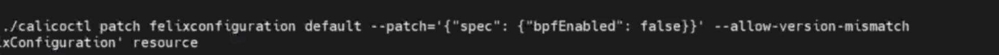

### Add proxy if needed	

```sh
cat <<EOF |sudo tee /etc/apt/apt.conf.d/proxy.conf
Acquire::http::Proxy "http://proxy-prc.intel.com:913/";
Acquire::https::Proxy "http://proxy-prc.intel.com:913/";
EOF

sudo apt update 


cat <<EOF | tee /etc/apt/apt.conf.d/proxy.conf
Acquire::http::Proxy "http://proxy-prc.intel.com:913";
Acquire::https::Proxy "http://proxy-prc.intel.com:913";
EOF

 apt update
 
 apt install iproute2 -y
```


```sh
echo '
function proxy_on() {
    export no_proxy="localhost,127.0.0.1/8,arch,.localdomain.com,10.0.0.0/24"

    local proxy='http://proxy-prc.intel.com:913'
    export http_proxy="$proxy" \
           https_proxy=$proxy \
           all_proxy=$proxy \
           ftp_proxy=$proxy \
           rsync_proxy=$proxy \
           HTTP_PROXY=$proxy \
           HTTPS_PROXY=$proxy \
           FTP_PROXY=$proxy \
           RSYNC_PROXY=$proxy
}

function proxy_off(){
    unset http_proxy https_proxy all_proxy ftp_proxy rsync_proxy \
          HTTP_PROXY HTTPS_PROXY FTP_PROXY RSYNC_PROXY
    echo -e "Proxy environment variable removed."
}'|tee -a ~/.bashrc
source ~/.bashrc
```


### Forwarding IPv4 and letting iptables see bridged traffic


```sh
cat <<EOF | sudo tee /etc/modules-load.d/k8s.conf
overlay
br_netfilter
EOF

sudo modprobe overlay
sudo modprobe br_netfilter

# 设置所需的 sysctl 参数，参数在重新启动后保持不变
cat <<EOF | sudo tee /etc/sysctl.d/k8s.conf
net.bridge.bridge-nf-call-iptables  = 1
net.bridge.bridge-nf-call-ip6tables = 1
net.ipv4.ip_forward                 = 1
EOF

# 应用 sysctl 参数而不重新启动
sudo sysctl --system

# check
lsmod | grep br_netfilter
lsmod | grep overlay
sysctl net.bridge.bridge-nf-call-iptables net.bridge.bridge-nf-call-ip6tables net.ipv4.ip_forward
```


Serproxy for docker 

```sh
sudo mkdir -p /etc/systemd/system/docker.service.d
  cat <<EOF | sudo tee /etc/systemd/system/docker.service.d/http-proxy.conf
[Service]
Environment="HTTP_PROXY=http://proxy-prc.intel.com:913"
Environment="HTTPS_PROXY=http://proxy-prc.intel.com:913"
Environment="NO_PROXY=localhost,127.0.0.0/8,10.293.154.0/16"
EOF
  sudo systemctl daemon-reload
  sudo systemctl restart docker
```


### Install Containerd

```sh
CONTAINERD_CERSION=1.7.0
wget https://github.com/containerd/containerd/releases/download/v$CONTAINERD_CERSION/containerd-$CONTAINERD_CERSION-linux-amd64.tar.gz 
sudo tar Czxvf /usr/local containerd-$CONTAINERD_CERSION-linux-amd64.tar.gz


wget https://raw.githubusercontent.com/containerd/containerd/main/containerd.service
sudo mv containerd.service /usr/lib/systemd/system/
sudo systemctl daemon-reload
sudo systemctl enable --now containerd
sudo systemctl status containerd

```

### Install Runc	

```sh
RUNC_VERSION=v1.1.4
wget https://github.com/opencontainers/runc/releases/download/$RUNC_VERSION/runc.amd64
sudo install -m 755 runc.amd64 /usr/local/sbin/runc
```


### Containerd configuration for Kubernetes

```sh
sudo mkdir -p /etc/containerd/
containerd config default | sudo tee /etc/containerd/config.toml
sudo sed -i 's/SystemdCgroup \= false/SystemdCgroup \= true/g' /etc/containerd/config.toml
sudo systemctl restart containerd
```


Set proxy for containerd

```sh
sudo mkdir -p  /etc/systemd/system/containerd.service.d/
cat <<EOF| sudo tee /etc/systemd/system/containerd.service.d/proxy.conf
[Service]
Environment="HTTP_PROXY=http://proxy-prc.intel.com:913/"
Environment="HTTPS_PROXY=http://proxy-prc.intel.com:913/"
Environment="NO_PROXY=localhost,127.0.0.1,10.239.0.0/16,10.244.0.0/16,10.96.0.0/16,10.0.0/24"
EOF
sudo systemctl daemon-reload
sudo systemctl restart containerd
```


###  Install kubeadm, kubectl, kubelete

```sh
sudo apt-get update
sudo apt-get install -y apt-transport-https ca-certificates curl
sudo -E curl -fsSLo /etc/apt/keyrings/kubernetes-archive-keyring.gpg https://packages.cloud.google.com/apt/doc/apt-key.gpg


echo "deb [signed-by=/etc/apt/keyrings/kubernetes-archive-keyring.gpg] https://apt.kubernetes.io/ kubernetes-xenial main" | sudo tee /etc/apt/sources.list.d/kubernetes.list

sudo apt-get update


k8s_version='1.25.3'
sudo apt-mark unhold kubelet kubeadm kubectl
sudo apt-get install -y \
    kubelet=${k8s_version}-00 kubeadm=${k8s_version}-00 \
    kubectl=${k8s_version}-00
sudo apt-mark hold kubelet kubeadm kubectl


```


### K8s cluster init

```sh
k8s_version='1.25.3'
pod_cidr='10.244.0.0/16'
service_cidr='10.96.0.0/16'
ipaddr='10.239.159.133'
sudo kubeadm init --kubernetes-version=${k8s_version} \
      --pod-network-cidr=${pod_cidr} --service-cidr=${service_cidr} \
      --apiserver-advertise-address=${ipaddr} \
      --cri-socket=unix:///run/containerd/containerd.sock
      

      
      
 mkdir -p $HOME/.kube
 sudo cp -i /etc/kubernetes/admin.conf $HOME/.kube/config
 sudo chown $(id -u):$(id -g) $HOME/.kube/config
 
 
 # let master also be a work node
 kubectl taint nodes --all node-role.kubernetes.io/master-
 kubectl taint nodes --all node-role.kubernetes.io/control-plane-
 
 
 
 
# kubectl autocomplete for bash
cat <<EOF | sudo tee ~/.alias
source <(kubectl completion bash)
alias k="kubectl"
complete -o default -F __start_kubectl k
EOF
echo 'source ~/.alias' >>~/.bashrc

source ~/.bashrc

 
# kubectl autocomplete for zsh

cat <<EOF | sudo tee ~/.alias
source <(kubectl completion zsh)
alias k="kubectl"
EOF
echo 'source ~/.alias' >>~/.zshrc

source ~/.zshrc
```


### Install CNI

```sh
wget https://raw.githubusercontent.com/coreos/flannel/master/Documentation/kube-flannel.yml

kubectl apply -f kube-flannel.yml
```


### Add work node

```sh
kubeadm token create --print-join-command
```


| CRI                               | Path                                         |
| --------------------------------- | -------------------------------------------- |
| containerd                        | `unix:///var/run/containerd/containerd.sock` |
| CRI-O                             | `unix:///var/run/crio/crio.sock`             |
| Docker Engine (using cri-dockerd) | `unix:///var/run/cri-dockerd.sock`           |


### Reference

https://www.itzgeek.com/how-tos/linux/ubuntu-how-tos/install-containerd-on-ubuntu-22-04.html

https://kubernetes.io/docs/setup/production-environment/tools/kubeadm/install-kubeadm/

https://kubernetes.io/zh-cn/docs/setup/production-environment/container-runtimes/


Docker Install

```sh
```


 DNA 





Singapore

```sh
k8s_version='1.24.6'
pod_cidr='10.240.0.0/16'
service_cidr='10.96.0.0/16'
ipaddr='10.0.3.9'
sudo kubeadm init --kubernetes-version=${k8s_version} \
      --pod-network-cidr=${pod_cidr} --service-cidr=${service_cidr} \
      --apiserver-advertise-address=${ipaddr} \
      --cri-socket=unix:///run/containerd/containerd.sock
```


tokyo

```sh
k8s_version='1.24.6'
pod_cidr='10.241.0.0/16'
service_cidr='10.96.0.0/16'
ipaddr='10.0.2.35'
sudo kubeadm init --kubernetes-version=${k8s_version} \
      --pod-network-cidr=${pod_cidr} --service-cidr=${service_cidr} \
      --apiserver-advertise-address=${ipaddr} \
      --cri-socket=unix:///run/containerd/containerd.sock
```


