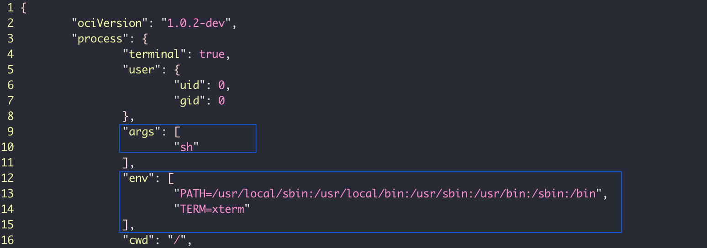
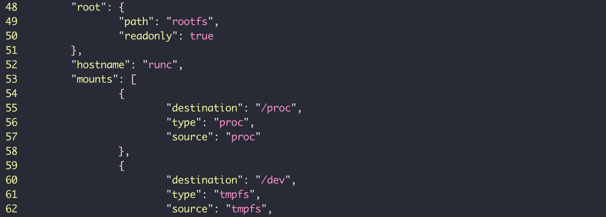
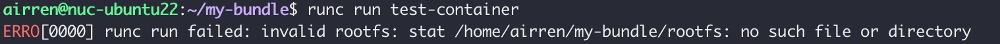
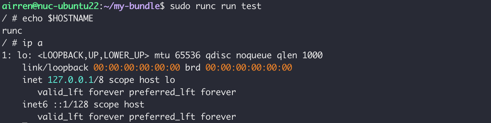
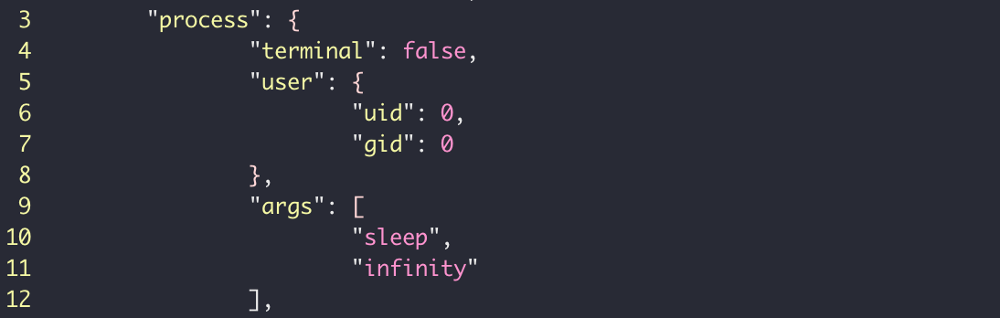
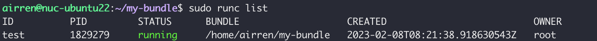
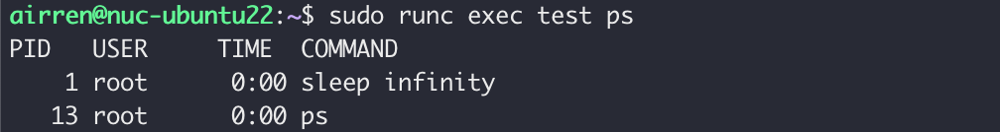
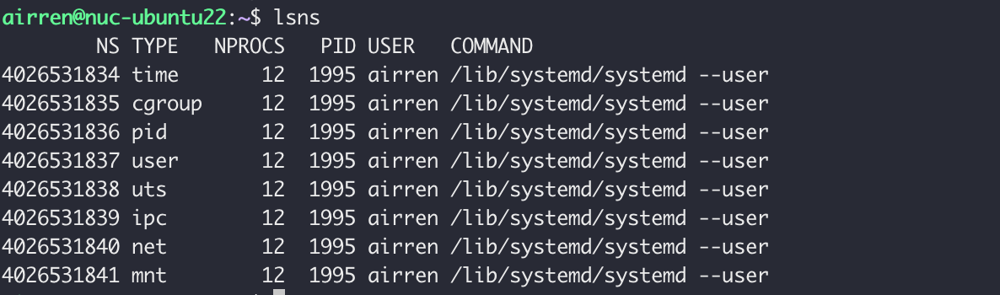

ctr 是containerd的客户端工具

crictl 是 CRI 的命令行接口， 可能是docker， 也可能是containerd， 也可能是podman


## OCI

runc是docker 底层的runtime， 由libcontainer 发展而来，最初是由Docker公司提出。


> The Open Container Initative is an open goverance structure for the express purpose of creating open industry stanards around container formats an runtimes.
>
> Established in June 2015 by Docker and other leaders in the container industry, the OCI currently contains three specifications: the Runtime Specification(runtime-spec), the Image Specification(image-spec) and the Distribution Specification(distribution-spec). 
>
> The Runtime Specification outlines how to run a "filesystem bundle" that is unpacked on disk.
>
> At a high-level an OCI implementation would download an OCI Image then unpack that image into an OCI Runtile filesystem bundle. At this point the OCI Runtime Bundle would be run by an OCI Runtime.
>
> 


一个镜像就是打包好的符合OCI规范的fileSystem bundle。filesystem bundle包含一个config.json文件和一个rootfs目录。

User-> Docker CLI -> Docker Daemon -> Containerd -> runc

User-> Podman -> runc

​        -> Cri-O -> runc

​        -> Containerd -> runc

Open Container Initative （OCI）。

runc 符合此规范，同时符合此规范的还有 kata container 和 gVisor 的虚拟机。


## RUNC


Runc 是OCI的一个具体实现， runc的前身是来自docker 的libcontainer。runc 直接与容器依赖的linux kernel 进行交互， 为容器的配置启动所需的namespace, 创建容器进程。


runc 希望提供一个OCI包，它只是`一个根文件系统和一个config.json 的文件`。 而不是像Podman或Docker 那样由Image的概念。所以不能使用这样的`runc run nginx:latest`命令去运行一个container。

runc 符合OCI规范，具体来说就是 runtime-spec. 这意味着他可以使用一个OCI包，并从中运行一个容器。这个bundle并不是容器镜像。 有单独的OCI-spec (image - spec)定义镜像。


### Install Runc


Bundle 是由下载后的镜像解压得到的。

OCI-Image - > OCI Runtime Bundle - > OCI Runtime


### OCI bundle for Runc

我们使用runc 创建一个容器，首先要准备OCI bundle.

OCI bundle 就是值容器的rootfs和一个config.json文件。

首先，使用runc 创建一个config.json 文件。新建一个文件夹，把所有的文件都存储在这个目录下面，在这个目录中构建OCI包的config.json文件：

```sh
makedir my-bundle
cd my-bundle
runc spec
```

执行完上述命令后，会在my-bundle目录下生成一个config.json文件。在这个配置文件中指定了容器在要运行那个进程，以及运行时需要的环境变量。



还定定义了在哪里查找根文件系统, 以及默认的挂载，主机名等。




在这个文件中，大部分内容是与平台无关的，操作系统相关的内容会放置在对应 系统类型下。 如果在linux系统中会会看到一个linux的子项。

此时，我们已经有了一个config.json文件，但是还没有根文件系统。 如果此时运行` runc run test-container` 就会得到一个错误，提示没有rootfs。



接下来, 我们需要为runc 提供一个rootfs，这里我们使用busybox的rootfs

```sh
docker export $(docker create busybox) | tar -C /mycontainer/rootfs -xvf -
```


使用runc 运行OCI bundle, 此时需要使用root权限。

```sh
sudo runc run test
```



这样我们就进入了一个新创建的容器的shell。 默认是以foreground的模式运行的一个容器。


此时如果我们终止与该机器的ssh会话，runc的进程也会终止。


runc  的容器配置是通过 config.json 配置的。我们将容器中的 command 设置为 `sleep infinity`。 termial: true   表示以终端的方式启动，如果使用detach的方式这个位置要设置为false, 否则会报错。



接下来使用detach的方式运行这个容器

```sh
sudo runc run test --detach
```

通过runc list 我们可以看到真正运行的容器




> runc 的namespace
>
> 

runc 是在文件系统上保持状态，默认情况下在 `/run/runc/CONTAINER_NAME/state.json`。


当在detach模式下运行的时候， 原始的runc 命令和这个容器进程之间没有任何关系， 此时容器的父进程id是1.


Docker， containerd， CRI-O 等都是使用detach模式。 它们的目的是简化runc和容器管理工具之间的集成。

runc 本身并不是某种类型的库，而是一个cli。 

容器在hsot上看到的进程号是 `1829279`， 但是在容器里面，这个进程的id是 `1`.



这个功能是由于linux的 namespace 技术实现的，这是容器背后的基本技术之一。 可以使用lsns列出当前系统支持的所有的linux的namespace.


