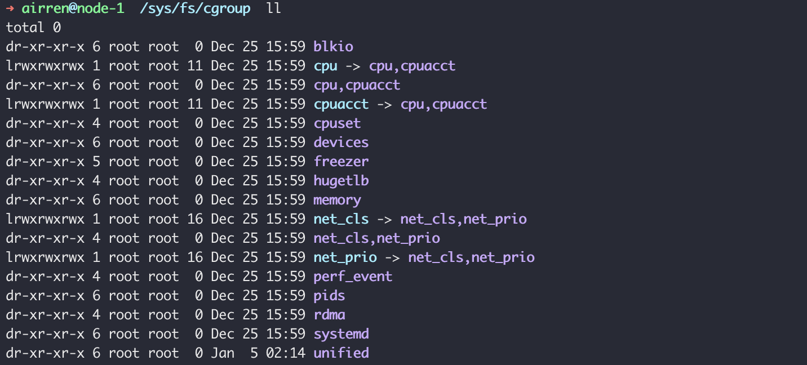
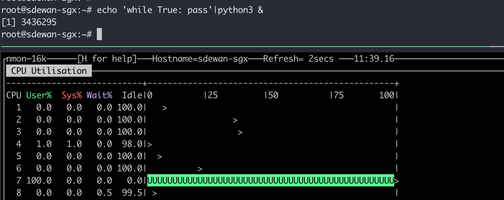
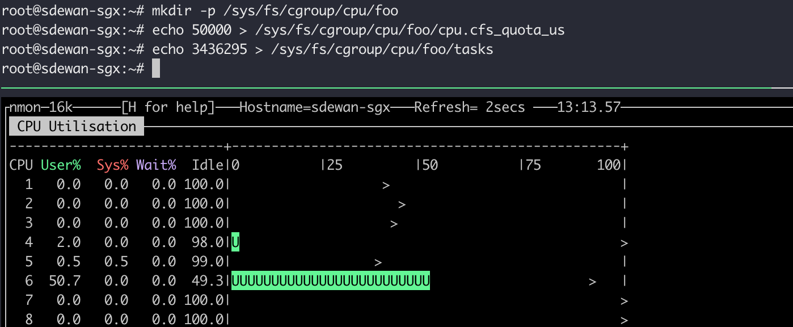
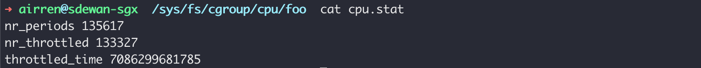

Linux cgroup 的全称是 Linux Control Group. cgroup的主要作用是限制一个进程能够使用的资源上限。包括cpu，memory，磁盘，网络带宽。


## Cgroup v1 vs v2

目前cgroup 主要有两个版本，cgroup v1 和cgroup v2。cgroup v1发布于2008年。目前ubuntu22.04 易默认使用cgroup v2版本。

检查当前linux发行版使用的是那个一版本的cgroup ，可以运行这条命令：

```sh
stat -fc %T /sys/fs/cgroup/
```

如果是cgroup v1，输出为`tmpfs`, 如果是cgroup v2输出为`cgroupfs`.

Cgroup 的默认路径是 `/sys/fs/cgroup`，v1 和v2版本的目录结构是不同的。

cgroup v1的目录结构




Cgroup 的默认路径是 `/sys/fs/cgroup`

```sh
# find cgroup path by cgroup id
find /sys/fs/cgroup -inum 5505
```


## Difference

1. cgroup v1 中一个cgroup id 可能对应多个cgroup path， 


```bash
vi /etc/dnsmasq.conf
# 在dnsmasq.conf中添加以下内容
log-queries
```


### CPU limit

cgroups里，可以使用`cpu.cfs_period_us` 和`cpu.cfs_quota_us` 来限制该组中所有进程在单位时间内可以使用的cpu时间。cfs是完全公平调度器(complete fairly scheduler)。`cpu.cfs_period_us`就是时间周期，默认为100000us, 即为100ms. `cpu.cfs_qutoa_us`是在这段时间周期内可以使用cpu的时间，默认为-1， 即无限制。


以cgroup v1接下来我们写个死循环，此时可以看懂cpu的占用率为100%

```sh
 echo 'while True: pass'|python3 &
```




接下来我们创建一个cpu 的cgroup, 将cpu的使用率限制在50%。 需要使用root权限。

```sh
mkdir -p /sys/fs/cgroup/cpu/foo
echo 50000 > /sys/fs/cgroup/cpu/foo/cpu.cfs_quota_us
echo 3436295 > /sys/fs/cgroup/cpu/foo/tasks
```




另外， `cfs_quota_us`也是可以大于`cfs_period_us`的，这主要是对于多核, 并且多线程的情况。有n个核时，一个控制组中的进程最多就能用到n倍cpu时间。 控制组中的多个进程将share 控制组的quota。 这两个值在cgroups层次中是有限制的，下层的资源不能超过上层。具体的说，就是下层的`cpu.cfs_period_us`值不能小于上层的值，`cpu.cfs_quota_us`的值不能大于上层的值。

`cpu.stat`就是对资源限制的统计。nr_periods, nr_throttled 就是总经过的周期，和其中受限制的周期。`throttled_time` 就是总共被控制组掐掉的cpu使用时间。



`cpu.share`是控制各个组之间的cpu配额。


cgroups除了用来限制资源使用外，还有资源统计的功能。做云计算的计费也可以用到cgroup。 Cgroup 有一个`cpuacct`的子系统专门用来做cpu资源统计。`cpuacct.stat` 统计了该控制组中进程用户态和内核态的 cpu 使用量，单位是 USER_HZ，也就是 jiffies、cpu 滴答数。每秒的滴答数可以用 getconf CLK_TCK 来获取，通常是 100。将看到的值除以这个值就可以换算成秒。`cpuacct.usage` 和 `cpuacct.usage_percpu` 是该控制组中进程消耗的 cpu 时间，单位是纳秒。后者是分 cpu 统计的。


> CPU affinity: 
>
> 如果cpu被一个线程绑定之后，还可以被其他线程绑定吗？

https://cloud.tencent.com/developer/article/1888808


linux namespace

https://cizixs.com/2017/08/29/linux-namespace/

https://www.cnblogs.com/sparkdev/p/9365405.html

https://blog.csdn.net/m0_59949484/article/details/124666051

https://zhuanlan.zhihu.com/p/149886216

https://blog.csdn.net/shuningzhang/article/details/89914371

https://dandelioncloud.cn/article/details/1530457353073999874
