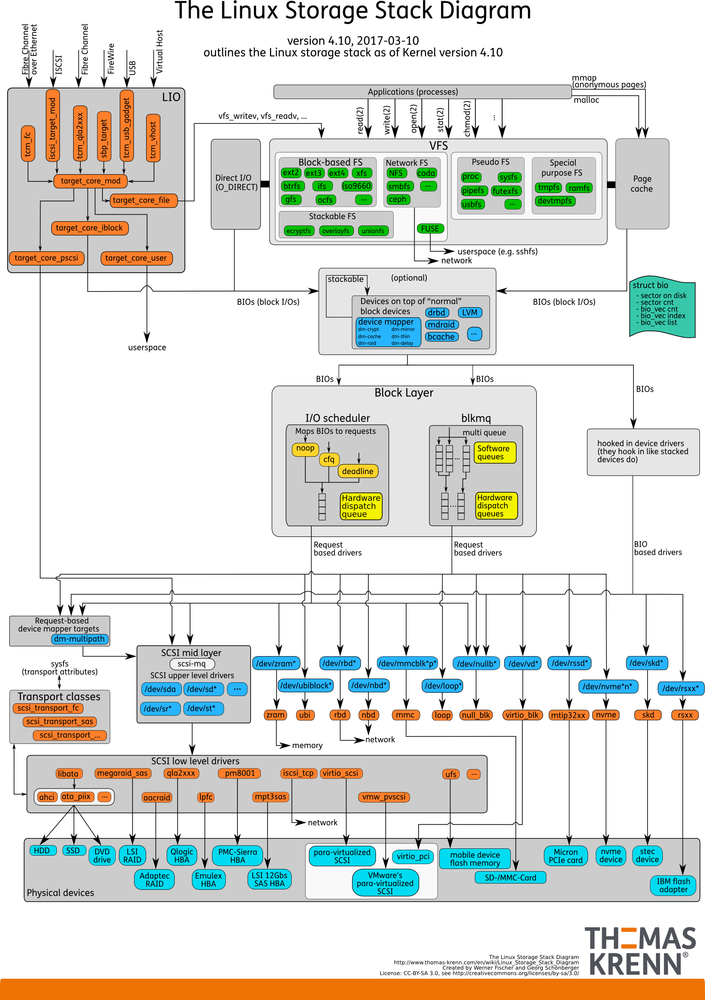
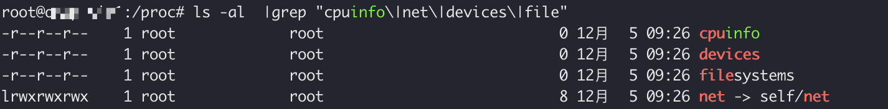
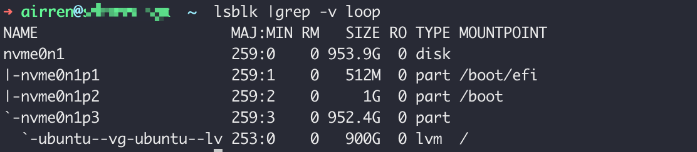
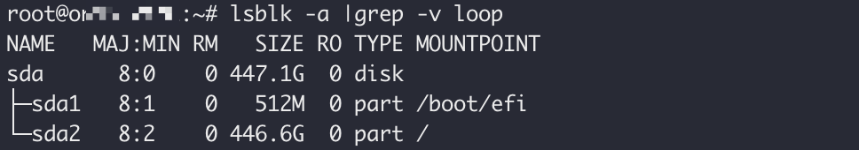
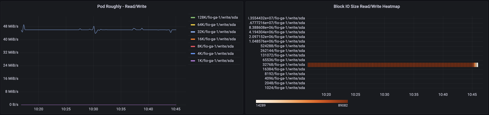
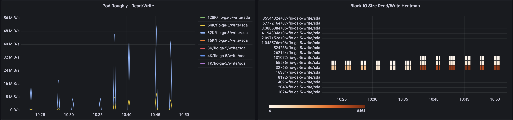

>
>
>什么是块设备 block device? Lsblk
>
>文件系统与磁盘格式化？ Fat， ntfs, ext4
>
>什么是文件系统，什么是VFS，之间的关系是怎样的？


这张图是linux 存储栈的架构图，从这张图，我们可以将整个架构简化为一下几层。从上到下依次为VFS,Block Layer, Physical devices.





## VFS

介绍VFS之前，先了解一下什么是文件系统。

在使用一块新的硬盘或者U盘的时候，我们首先会对硬盘进行格式化，在格式化的时候我们会选择文件系统的类型，例如FAT32,ext4. 这个就是File System的类型。

File System是对存储设备上的文件进行组织管理的机制。 组织方式不同就会形成不同的文件系统。


文件系统可以分为三类：

- 基于磁盘的文件系统：也就是把数据直接存储在计算机本地挂在的磁盘中。 常见的有 ext4， NFS

- 基于内存的文件系统： 也就是虚拟文件系统。这类文件系统不需要任何磁盘分配存储空间，但会占用内存。 例如`/proc` ,`/sys`。 这类文件系统主要是为了向用户空间导出层次化的内核对象。该目录中的数据并不保存在硬盘上，而是保存到内存中。主要保存系统的内核，进程，外部设备状态和网络状态等。例如，`/proc/cpuinfo`是保存cpu信息的，`/proc/devices` 是保存设备驱动列表， `/proc/filesystems` 是保存文件系统列表的。/proc/net 是保存网络协议信息的。

  

- 网络文件系统:  用来访问位于其他计算机的文件系统，例如: NFS, SMB, Ceph


所有的文件系统都要先挂在在VFS目录树中的某个子目录(挂载点)，然后才能访问其中的文件。

以磁盘类文件系统为例， 安装系统时需要先挂载一个根目录(/), 在根目录下再把其他文件系统(其他磁盘分区，/proc 文件系统/sys 文件系统，NFS等)挂载进来。


为了支持不同的文件系统，Linux Kernel在用户进行和文件系统中间，又引入了一个抽象层， 也就是虚拟文件系统VFS。VFS定义了一组所有文件系统都支持的数据结构和标准接口。

Application通过系统调用与VFS(Virtual File System)交互，VFS为Application屏蔽掉了底层文件系统的不同。对于Application来说，只需要与VFS提供的统一接口交互，不需要关注文件系统的具体实现。对于文件系统来说，只需要按照VFS的标准，就可以支持各种应用程序。

VFS通过目录项，索引节点，逻辑块以及超级块等数据结构来管理文件。


基于磁盘的文件系统：

- 索引节点: inode, index node, 记录文件的元数据。inode 编号，文件大小，访问权限，修改日期，数据的位置等。inode与文件一一对应，它跟文件的内容一样，都会被持久化存储到磁盘中。inode同样会占用磁盘空间。
- 目录项：dentry, directory entry 记录文件的名字，索引节点指针，以及与其他目录项的关联关系。多个关联的dentry就构成了文件系统的目录结构。目录项是由内核维护的数据结构，通常被叫做目录项缓存。


> inode是每个文件的唯一标志，dentry维护的是文件系统的树状结构。dentry和 inode是多对一的关系。一个文件可以有多个别名。
>
> 通过硬链接为文件创建别名，就会创建不同的dentry, 不过这些文件本质上是链接到同一个文件，所以他们的inode相同。
>
> 硬链接和源文件的inode节点号相同。软连接和源文件的inode节点号不同，进而指向的block也不同，软连接block中存储的是源文件的路径名

- 逻辑块：连续磁盘扇区构成的最小读写单元，用来存储文件数据
- 超级块：用来记录文件系统的整体状态，如索引节点和逻辑块的使用情况。

Dentry是一个内存缓存；而超级块、索引节点和逻辑块都是存储在磁盘中的持久化数据。为了协调慢速磁盘与CPU的性能差异，文件内容会缓存到Page Cache中。inode也会缓存到内存中。


磁盘在执行`文件系统`格式化时，会分成三个存储区域： 超级块，索引节点和数据块区。

- 超级块: 存储整个文件系统的状态
- 索引节点区：用来存储索引节点
- 数据块区: 用来存储文件数据


VFS 包含Block-based FS, Network Fs, Stackable FS, Pseudo FS, Special purpose FS.  VFS 为上层的应用程序提供标准的文件访问接口；对下层会通过Block Layer 来实际存储和管理磁盘数据。


### Block-based FS

File System  fat ext4


## Block Layer

Block Layer 是linux磁盘I/O的核心，向上为文件系统和应用程序提供了`访问块设备的标准接口`，向下，把各种异构的磁盘设备抽象为统一的块设备，并通过统一的框架来管理这些设备的驱动程序。另外， Block Layer 会对文件系统和应用程序发来的I/O请求排队，并通过重新排序、请求合并等方法，提高磁盘的访问效率。

Black Layer 包括块设备`IO队列和IO调度器`。会对文件系统的IO请求进行重新排队，在通过重新排序和请求合并，然后才会发送到Physical Device.

对VFS发来的IO请求进行排序，就是IO调度。Linux kernel 支持4种IO调度算法，NONE, NOOP, CFQ以及Deadline。

- NONE: 完全不使用IO调度器，对文件系统和Application的IO不做任何处理。常用在VM中，此时磁盘的IO调度完全由Host负责。
- NOOP：是一个FIFO的队列，只做一些基本的请求合并，常用于SSD.
- CFQ(Completely Fair Scheduler)： 是很多发行版默认的IO调度器，`为每一个进程维护了一个IO调度队列`，并按照时间片来均匀分布每个进程的IO请求。CFQ还支持进程IO的优先级调度。
- Deadline: 分别为读写请求创建了不同的IO队列，可以提高机械磁盘的吞吐量，并确保达到Deadline的请求优先被处理。多用在IO压力比较重的场景，例如数据库。

## Physical Devices

物理设备的IO通常是整个系统中最慢的一环，所以Linux 会通过多种缓存机制来优化IO的效率。为了优化文件访问的性能，会使用页缓存，索引节点缓存，目录缓存等多种缓存机制，以减少对物理设备的直接调用。

Physical Devices 包括存储设备和相应的驱动程序， 负责最终物理设备的IO操作。


### Disk

Disk是可持久化的存储，根据存储介质不同，目前主要分为两类HDD/SSD.

### HDD

HDD(Hard Disk Driver): 机械磁盘主要由盘片和读写磁头组成，数据就存储在磁盘的磁道中。在读写数据前需要移动磁头，定位到数据所在的磁道，然后才能访问数据。如果IO请求刚好连续，就不需要磁道寻址，可以连续读取节省寻道时间。如果是随机IO，需要不停地移动磁头，访问效率就会变慢。


### SSD

`HDD的最小读写单位是扇区，一般大小为512Byte.`

`SSD的最小读写单位是Page, 通常大小是4K,8K等。`


如果每次读写都是512Byte的话，效率比较低。`文件系统会把连续的扇区或者页组成逻辑块，然后以逻辑块作为最小单元来管理数据。常见的逻辑块的大小是4K`。所以连续8个扇区，或者单独的一个页，都可以组成一个逻辑块。


除了按照存储介质分类，另外的一个常见的分类方法是按照接口来分。例如: IDE(Intergrated Drive Electronics), SCSI(Small Computer System Interface), SAS(Serial Attached SCSI), SATA(Serial ATA), FC(Fibre Channel)等。不同的Interface会分配不同的设备名，例如最常见的SCSI和SATA设备会分配一个sd前缀的设备名(such as, /dev/sda /dev/sdb, etc.);如果是nvme设备则会分配一个nvme前缀; 如果是IDE设备则会分配一个hd的前缀。




### Disk Usage

Disk最直接的使用方式就是作为独立磁盘设备(块设备)使用，有时候可以根据需要划分逻辑分区，每个分区再用数字编号。



另一个比较常用的架构是RAID(Redundant Array of Independenet Disk) , 把多块磁盘通过磁盘阵列组合成一个逻辑磁盘，从而提高磁盘的读写性能或可靠性。一般RAID方式有以下几种

| RAID    | Number(At least) | Realibility | Read/Write |
| ------- | ---------------- | ----------- | ---------- |
| RAID 0  | 2                | No          | > 200%     |
| RAID 1  | 2                | Yes         | 50%        |
| RAID 5  | 3                | Yes         | > 100%     |
| RAID 10 | 4                | Yes         | 100%       |

磁盘是作为一个Block Device 来管理的，以快为单位读写数据，并且支持随机读写。 每个块设备都会被赋予两个设备号，分别是主次设备号。主设备号用在驱动程序中，用来区分设备类型，而此设备号则是用来给多个同类设备编号。


## 文件系统I/O


`Block 是文件系统的最小寻址单元`


把文件系统挂载到挂载点后，你就能通过挂载点再去访问它管理的文件了。VFS提供了一组标准的文件访问接口，这些接口以系统调用的方式，提供给应用程序使用。


以cat命令为例， 它首先调用open()，打开一个文件，然后调用read()，读取文件所有内容，最后再调用write(), 把文件内容输出到标准输出中:

```c
int open(const char *pathname, int flags, mode_t mode); 
ssize_t read(int fd, void *buf, size_t count); 
ssize_t write(int fd, const void *buf, size_t count); 
```


文件读写方式的各种差异，导致IO的分类多种多样。 最常见的有， 缓冲/非缓冲IO，直接/非直接IO，阻塞/非阻塞IO，同步/异步IO.

### 缓冲/非缓冲: 是否利用标准库缓存（读）

用户空间的缓冲

- 缓冲IO， 是指用标准库缓存来加速文件的访问，而标准库内部再通过系统调用访问文件。

- 非缓冲IO, 是指直接通过系统调用来访问文件，不在经过标准库的缓存。

  这里所说的缓冲，是标准库内部实现的缓存，比方说，很多应用程序遇到换行时才会真正输出，而换行前的内容，其实就是被标准库暂时缓存了起来？？？

无论是缓冲还是非缓冲IO，最终还是要通过系统调用来访问文件。系统调用后，还会通过Page Cache来减少磁盘IO的操作。

### 直接/非直接I/O：是否利用操作系统的Page Cache(写)

- 直接IO,  是指跳过操作系统的Page Cache，直接跟文件系统交互来访问文件。
- 非直接IO, 文件读写时，要先经过系统的Page Cache，然后再由内核或额外的系统调用，真正写入磁盘。

如果想要实现直接IO，需要在系统调用中指定`O_DIRECT`标志. 如果没有设置，默认是非直接IO.

直接/非直接IO 本质上还是与文件系统交互。如果是在数据库场景中，你还会看到跳过文件系统读写磁盘的情况，也就是`裸I/O`

举个例子🌰， 

用Fio 测试32k随机写,分别使用直接IO/Buffered IO. 通过ebpf 采集bio的数据。左边为通过ebpf bio计算出来的粗略的读写速度，右边为实际Block层在写磁盘时的bio的大小。

使用Direct IO时，bio的大小与fio设定相同。且从左边的图看出，写是非常连续的。



使用Buffered IO时， bio的大小>= fio的设定。并且从左边的图可以看出，此时的写并不是连续的，经过Page Cache的缓存，之后才会把Page Cache 中的数据统一写入磁盘。在从PageCache写入磁盘的过程中，bio的size >=32, 可以减少IO次数，提高写入速率。




阻塞/非堵塞


由于磁盘的速度远小于CPU, 文件系统又通过Page Cache, Dentry Cache, 以及inode cache减少磁盘延迟对程序运行的影响。


在Unix系 系统中，一切皆文件，所有的硬盘。键盘，网卡等设备都有文件来代表，对应/dev 下面的文件。对于应用程序来说，可以向对来普通文件一样打开，关闭，读写这些设备文件。例如 /dev/sda, 这种类型是用户空间的名称，Os kernel不知道这个名称代表什么，在内核空间是通过major，minor device number来区分设备的。


major device number: 可以看做是设备驱动程序，被同一设备驱动程序管理的设备相同的major device number. 这个数字在kernel 中实际是devcie driver table的索引，这个表保存着不同的设备驱动程序。

minor device number: 代表被访问的具体设备。Kernel根据 maijor device number 找到设备驱动程序，然后再通过 minor device number 获得设备位置等属性。


Read Head 存储介绍

https://access.redhat.com/articles/3911611


### Logical / Physical Block Size

https://docs.oracle.com/cd/E19253-01/817-5093/fsfilesysappx-9/index.html#:~:text=The%20physical%20block%20size%20is,KB)%20for%20UFS%20file%20systems.

https://blog.csdn.net/my_bai/article/details/73331360

https://blog.csdn.net/yimenglin/article/details/107854978

https://zhuanlan.zhihu.com/p/117375905

https://zhuanlan.zhihu.com/p/285665677

https://www.cnblogs.com/l1pe1/p/8328948.html

https://blog.51cto.com/u_15169172/2985843

https://www.chinastor.com/jishu/FS/1016340R012.html?mobile_redirection=false

https://www.zhihu.com/question/57942990

https://bytegopher.goatcounter.com/user/new

https://blog.csdn.net/weixin_39789327/article/details/116876948


逻辑块(Logic Block Size)大小是UNIX内核用来读取或写入文件块的大小。缺省情况下，逻辑块的大小为系统的页(Page)的大小。对于UFS文件系统，缺省的逻辑块大小为8KB。UFS文件系统支持4K或8K的大小，建议逻辑块为8K。

物理块(Physical Block Size)的大小通常为512Byte，这是磁盘控制器可以读取或者写入的最小块的大小。例如对于HDD，逻辑块的大小为512Byte，对应一个扇区的大小。对于SSD，一个物理块的大小为4KiB.  Physical Block Size, Physical Sector.


物理块的大小定义为sector的整数倍。


文件系统操作的基本单位是逻辑块，只有需要在进行IO操作时，才进行逻辑块到物理块的映射。 逻辑块的大小必须是物理块大小的整数倍。


> 块设备Block Device和字符设备 Character Device
>
> 在/dev 目录下，块设备用b表示，c表示字符设备。
>
> 块设备主要是用于存储
>
> 字符设备一般是指通用设备

https://blog.csdn.net/qq_34556414/article/details/108705650

https://blog.csdn.net/allway2/article/details/108371452